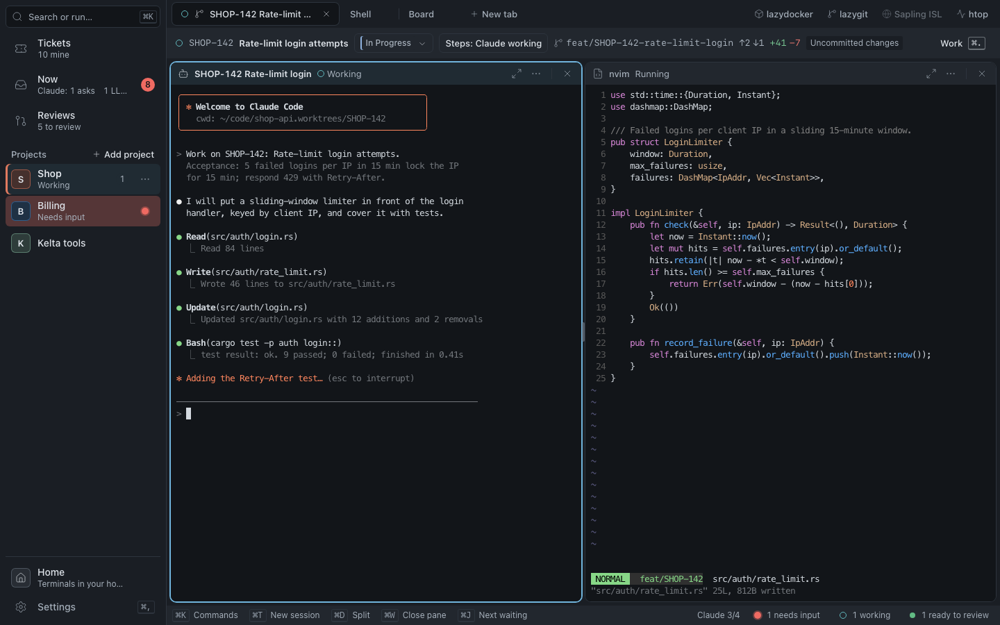
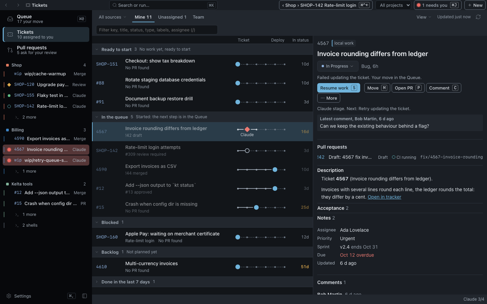
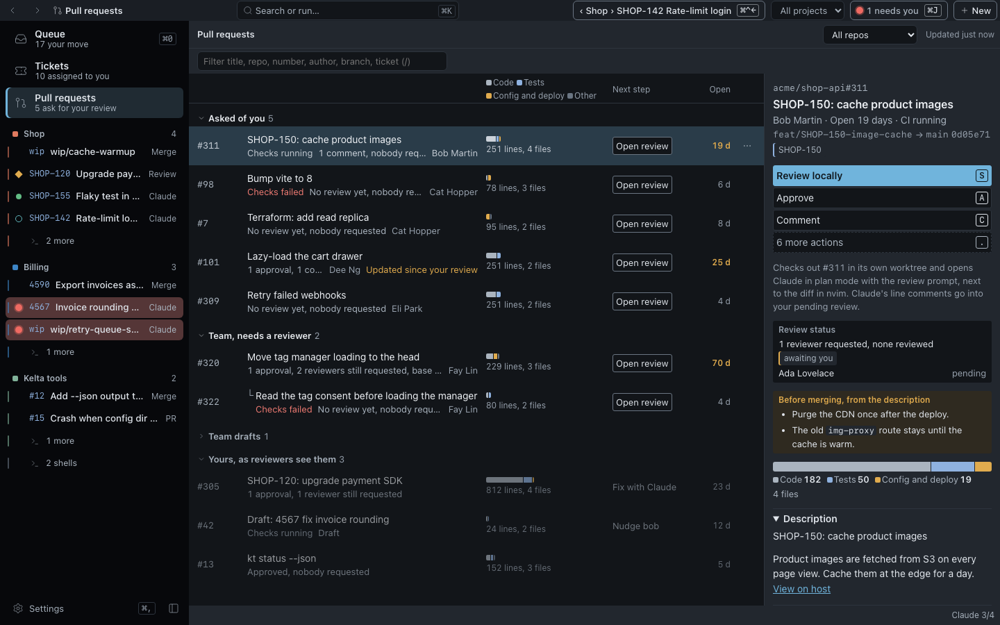

# Kelta

Pick a ticket, get Claude Code and nvim side by side in its own worktree, review the pull requests waiting on
you, all in one light desktop window.

[](LICENSE)
[](https://github.com/InjustFr/kelta/releases)




| Tickets, from every project | Reviews, list and detail |
|---|---|
|  |  |

## Why Kelta

- **One key from ticket to code.** Select a ticket, press `s`: Kelta creates the worktree and branch, moves the
  ticket to In progress, and opens Claude (already briefed on the ticket) next to nvim.
- **Review without leaving the app.** The pull requests you are asked to review sit next to your tickets: read,
  approve, request changes, or check one out in a worktree with Claude and a diff in nvim.
- **Many projects, one light window.** Every project and session stays live when you switch. Memory budget: under
  220 MB on macOS (250 MB on Linux) for 3 projects and 10 live sessions, 60 MB with the window closed.

## Features

Kelta 1.0 runs on macOS 13+ and on Ubuntu 24.04+ (Hyprland, Sway, GNOME). Desktop app built with Tauri v2,
Svelte 5 and Rust. The [user guide](docs/user/README.md) covers everything below.

**Tickets & work items**

- Jira, Redmine, GitHub Issues and Projects v2, GitLab, Gitea/Forgejo and Linear, several sources per project:
  [working with tickets](docs/user/tickets.md#sources).
- **Tickets**, **Now** and **Reviews** on the rail work across every open project; Now shows what waits on you:
  [first launch](docs/user/getting-started.md#first-launch).
- A keyboard-first list grouped by flow (Doing, Waiting, Ready), with a detail column, status moves and bulk
  moves, or a board: [keys](docs/user/tickets.md#keys).
- Start work in the right project: Kelta proposes the ticket's project and remembers your pick; per-ticket options
  in the plan sheet; a list of unfinished work before you start another ticket:
  [starting a session](docs/user/tickets.md#starting-a-session).
- Per source: a Jira board and status filters, status colours, tracker fields as chips on the rows, a blocked
  marker, grouping by parent: [per-source settings](docs/user/tickets.md#per-source-settings),
  [blocked tickets](docs/user/tickets.md#blocked-tickets).
- Local tags, kept in Kelta, on tickets and pull requests, with a filter in the toolbar:
  [local tags](docs/user/tickets.md#local-tags).

**Reviews**

- Review requests and your own PRs (GitHub, GitLab, Bitbucket Cloud, Gitea/Forgejo) with CI, review state and
  linked tickets: [pull requests](docs/user/tickets.md#pull-requests),
  [Bitbucket](docs/user/bitbucket.md), [Gitea](docs/user/gitea.md).
- Approve, comment, request changes, or review locally in a worktree; mark your own draft ready, or convert it
  back; nudge slow reviewers: [reviews](docs/user/reviews.md).

**Claude integration**

- Claude's state (working, needs you, done) on every pane, tab and project, from Claude Code hooks:
  [next step](docs/user/tickets.md#next-step).
- Kelta's MCP ticket tools in any Claude session, not only the ones Kelta starts:
  [tickets from any Claude session](docs/user/tickets.md#tickets-from-any-claude-session).
- Refine a ticket with Claude (`r`): acceptance criteria, open questions and sub-tasks to post or keep:
  [keys](docs/user/tickets.md#keys).
- Set Kelta up by asking Claude (**Set up with Claude**), answer a workflow's questions with buttons, and run
  prompt or slash-command workflows on a ticket, a pull request or on their own:
  [Claude](docs/user/claude-code.md).
- Claude sessions you start in another terminal show in Now, and Kelta jumps to their tmux pane or window; a
  session template can run Claude in your own terminal or in tmux: [Claude](docs/user/claude-code.md).

**Tools**

- lazygit, lazydocker, k9s, `sl web` or an app like Fork, defined once in Global settings and opened from the tab
  bar where you are: [tools](docs/user/tools.md).

**Interface**

- English, French and German (`app.language`); a sidebar you can resize and collapse (`Cmd+B`, `Ctrl+Shift+S`);
  panes you drag to rearrange, or out of the window to open them in their own window; closed projects you can
  reopen: [getting started](docs/user/getting-started.md#the-rail).
- Dark and light theme slots, and import from VS Code, iTerm2, Ghostty, Kitty, Alacritty or base16:
  [themes](docs/user/themes.md).

**Plugins**

- Tools, palette commands, screens, and actions on tickets, PRs and work items:
  [writing a plugin](docs/plugins-guide/README.md), [act on a ticket, a PR or a branch](docs/plugins-guide/acting-on-work.md).

## Install

Download a build from the [Releases page](https://github.com/InjustFr/kelta/releases). There are two channels:

- **Stable**: the numbered releases (1.0.0 and later). Take the latest one.
- **Nightly**: the rolling `nightly` prerelease, rebuilt every night from the newest `main` commit that passed CI,
  when `main` has moved. It has the newest changes and rough edges.

| Platform | Stable | Nightly |
|---|---|---|
| macOS 13+, Apple silicon (no Intel Macs) | `Kelta_*_aarch64.dmg` | same |
| Linux, any distro | `kelta_*_amd64.AppImage` / `kelta_*_aarch64.AppImage` | same |
| Debian, Ubuntu 24.04+ | `kelta_*_amd64.deb` / `kelta_*_arm64.deb` | same |

`SHA256SUMS` is attached to each release. The nightly's notes list the commit and the changes since the previous
build. If no build fits your machine, [build from source](#build-from-source).

Kelta updates itself, on the channel it was installed from: a stable install gets stable releases, a nightly
install gets nightlies, and neither moves to the other. To change channel, install the other build. The new
version installs in the background and a banner offers **Restart** (sessions kept by keltad keep running).
Settings > General > Updates shows the version and channel and has **Check now**; `app.updates = false` stops the
automatic checks. Two installs cannot update themselves: a `.deb` (apt owns the files, so install the new `.deb`
from the Releases page), and a macOS app that is not in `/Applications`.

**macOS.** Open the dmg and drag Kelta to Applications. The app is ad-hoc signed, not notarized, so macOS asks
you to confirm the first launch: right-click Kelta and choose **Open**. On macOS 15 and later, open Kelta once,
then go to System Settings > Privacy & Security and click **Open Anyway**. Or remove the quarantine flag:

```sh
xattr -dr com.apple.quarantine /Applications/Kelta.app
```

Closing the window keeps sessions running (background mode); `kelta-ctl toggle` brings it back.

**Linux.** `chmod +x kelta_*_aarch64.AppImage && ./kelta_*_aarch64.AppImage`, or
`sudo apt install ./kelta_*_arm64.deb`. On x86_64 take the `amd64` files. It needs `libwebkit2gtk-4.1` and GTK 3.

- Hyprland and Sway: no title bar (`window.decorations = "auto"`); bind `kelta-ctl toggle` to a key
  ([compositors](docs/user/compositors.md)).
- NVIDIA proprietary driver: Kelta turns off the DMABUF renderer and explicit sync; if the window stays blank,
  run `kelta --safe-graphics` ([graphics](docs/user/graphics.md)).
- GTK3 renders at integer scales, so fractional scaling can blur text.
- Notifications need a daemon (mako, dunst, swaync) and stored tokens a Secret Service provider
  ([keyring and notifications](docs/user/keyring-and-notifications.md)).

## Quick start

1. **Add a project**: **Add project** in the rail, or `kelta-ctl open ~/code/shop`.
2. **Add a ticket source**: an account in Settings > Accounts, then **Pick a board** in Tickets (or **Add source**
   in Settings > Sources). Or let Claude do steps 1 and 2: the welcome sheet and the palette have **Set up with
   Claude**.
3. **Start work on a ticket**: **Tickets** (`Cmd+Shift+B`), select one, press `s`.
4. **Review a PR**: **Reviews** (`Cmd+Shift+R`), select one, **Approve** or **Review locally**.

The details are in [getting started](docs/user/getting-started.md).

## Build from source

Requirements: Rust 1.99, Node 22, pnpm 9, and on Linux `libwebkit2gtk-4.1-dev libgtk-3-dev
librsvg2-dev libayatana-appindicator3-dev libssl-dev libxdo-dev patchelf`.

```sh
pnpm install --frozen-lockfile
pnpm --filter @kelta/ui run build
cargo run -p kelta-desktop          # dev build (uses the Vite dev server: pnpm dev)
bash packaging/build.sh             # installers: deb + AppImage on Linux, dmg on macOS
```

## Contributing, security, license

- Bugs and feature requests: see
  [reporting bugs and requesting features](CONTRIBUTING.md#reporting-bugs-and-requesting-features).
- Contributing: [CONTRIBUTING.md](CONTRIBUTING.md). Before a pull request run `bash scripts/ci-local.sh`.
- CI time budget: each `ci` job ≤ 10 min with a warm cache, each `nightly`/`release` OS ≤ 25 min. The jobs time
  out at 15 min (ci rust), 10 min (ci ui) and 30 min (nightly, release), so a regression fails loudly.
- Security: report vulnerabilities as described in [SECURITY.md](SECURITY.md).
- License: [MIT](LICENSE).
