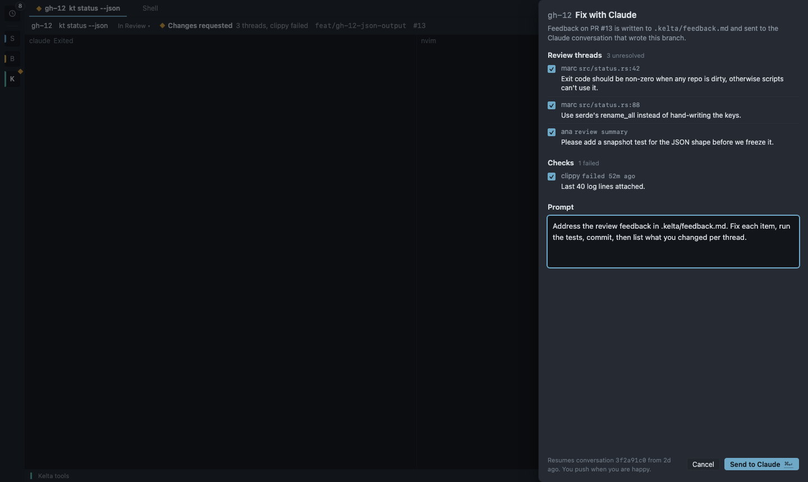
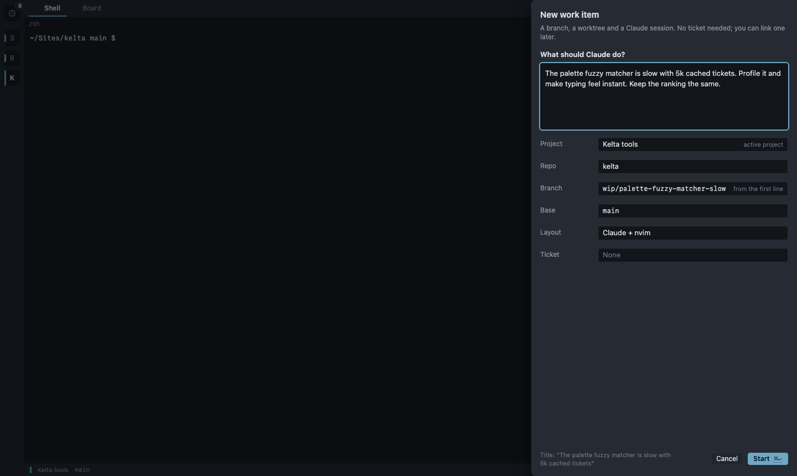

# Kelta flows

Status: built. Designed in lane `flow-ux` (revision 2, review issues resolved in §11.1) and brought in line with the code for 1.0.0 (revision 3). It covers flows, structure, interaction and missing features. Visuals come from [DESIGN.md](DESIGN.md) (Bezel: lamps, project hue, row grammar) and are not redecided here.

Inputs: the flow audit on the mock UI (screenshots in `images/flow-audit/`, `a*` to `d*`) and a read of the backend at `316bc1d`. Mockups for this document are in `images/flow/` (source `mockups.html`, render with `node docs/images/flow/render.mjs`).

The four flows this design serves, in Louis's words:

1. **Basic**: take a ticket, launch Claude on it, then review the code in nvim or on GitHub.
2. **Feedback**: resume the previous Claude session, with its context, to fix what review found.
3. **Ticket-free**: explore a feature or fix a bug in a session that will probably end in a PR, without a ticket.
4. **Rebase** my work.

And the two questions behind them, asked many times a day with many things in flight: *what do I have to review, from other people and from Claude?* and *where am I in my own work?*

---

## 1. Principles

### 1.1 The map

Kelta has three places and a sidebar (DESIGN §1.1):

- **Queue** (§3): where all work waits, across projects, ranked by whose move it is: **Your move**, **Claude working**, **Waiting on others**. It answers both questions on one screen.
- **Desk**: a work item's tab. Claude and nvim in panes, the desk header (key, title, why, the stage track, the next step, `Actions ⌘.`) and the Story panel, the item's story in stage order (§2.4).
- **Library**: **Tickets** and **Pull requests**, the lists to pick work from, under the one project scope of the top bar (§3).
- **Sidebar of work**: the three places, then each project's work items in a stable order (the order they started); every other tab folds into one **n more** row per project. It folds to its lamps while the Queue is shown.

The loop runs through them: pick a ticket in the Library, start it (`s`), Claude works on the Desk, the Queue calls you back when it stops (`⌘J`), you review (`↵`), ship (`p`), and the pull request waits on others in the Queue until it merges.

### 1.2 Rules

- **The work item is the unit of parallel work.** One branch, one worktree, one Claude conversation, at most one PR, with or without a ticket. Everything Louis does to his own code goes through a work item.
- **Every work item has exactly one next action**, derived from its state. The same action is `↵` on its row in the Queue, the primary button in its desk header, and `⌘.` `↵` from inside Claude or nvim. Learn one key, use it everywhere.
- **Five keys first.** `↵` the next step, `⌘.` the actions of whatever is selected, `⌘K` find anything, `⌘J` the next thing that needs you, `⌘0` the Queue and back (§7). A letter means the same in every list (§3.3). The prefix reaches every action, and its which-key panel lists them.
- **One call signal (the attention budget).** In the window only a Claude blocked on you calls: the top bar's "needs you" chip, the lit sidebar row. Everything else waits in the Queue without asking: a finished Claude does not notify by default (`notifications.claude_done`), and an info toast closes when you leave the view that raised it. Focus mode (§7) holds the other desktop notifications (review requests, checks, merges) and background toasts too, never a blocked Claude.
- **"Claude finished" is durable** until Louis acts on it. A glance at a tab never clears it.
- **Menus show what can run now.** What cannot comes last, with its reason (§2.5).
- **Automatic when reversible, confirmed when destructive.** Reading state, fetching, moving a ticket after merge: automatic. Force push, removing a worktree: confirmed in one keystroke, never batched.
- **No new polling.** State refreshes on events (hooks, `work.updated`, the review polls that already exist), on window focus, on startup and when the Queue opens.
- **Every flow is keyboard-complete**, including sheets, dialogs, toasts and stopped rebases (§7.1).
- **No ticket source is an onboarding step, not an empty list.** With no `[[sources]]` board, Tickets (every scope, Home included) shows "Add a ticket source: pick a board" and **Pick a board**; the Queue shows "No ticket source yet · Pick a board" above its rows; with no rows it shows **Your loop** until a first item has shipped (its second step is the board picker), else "Add a ticket source: pick a board" as its empty state. The picker creates a source labelled after the board (feeding the project it was opened from, else none) and its toast "… added · Choose its projects" opens Settings → Sources on it.

---

## 2. The work item

### 2.1 Kinds

| Kind | Created by | Branch | Title | Claude prompt |
|---|---|---|---|---|
| Ticket | Start work on a ticket | `worktree.branch_template` | ticket title | `claude.prompt_templates.ticket` |
| Scratch (`WorkKind::Branch`) | New work item (`⇧⌘N`), `kelta-ctl start --task` | `work.scratch_branch_template`, default `wip/{slug}` (slug of the task's first line) | first line of the task, 72 chars max | `standalone`, default now `"{task}"` |
| Review | Review locally on someone else's PR | `kelta/pr-<n>` | PR title | `review` |

A scratch item behaves like a ticket item in every way except tracker side effects. It can be linked to a ticket later (§4.3).

Review locally on **my own** PR never creates a `kelta/pr-<n>` item: it resumes the work item that owns the PR, or, for a PR made outside Kelta, adopts the PR's head branch as a scratch item so pushes update the PR (§9, bug B2).

Work items are git worktrees. Sapling is not a work-item backend (§11.2).

### 2.2 Phase: one derived state, one next action

`views/work/phase.ts` is a pure function, unit-tested, used by the Queue, the desk header, the sidebar lamp and the palette:

```ts
phaseOf(item: WorkItem, claude: SessionInfo | null, pr: Review | null, git: GitStatus | null): Phase
// Phase = { id, label, detail, lamp, primary: WorkAction | null, section: NowSection }
```

The first matching row wins. "Claude" below means the item's Claude session `status` (not `attention`).

| # | Condition | Label (detail) | Lamp | Primary action | Queue section |
|---|---|---|---|---|---|
| 0 | an open MCP `ask` question (#356) on the item's Claude, or on its run's session | the question | needs input | Go to Claude | Claude needs you |
| 0a | a background run holds the item (`WorkItem.run`, #235) and is not done | {workflow} {phase} (the run's note) | working; blocked amber (error); failed red (needs input); orphaned none | none | In flight (blocked and failed: Claude needs you) |
| 1 | `state = failed` | Failed at {step} ({message}) | error | Retry {step} (Skip step beside it) | Fix |
| 1a | `state = queued`: past `claude.max_live` live Claudes (#141) | Queued (waiting for a Claude slot) | none | Start now (over cap); Move to front on right-click | In flight |
| 2 | `state = starting` | Starting (step n of m) | working | none | In flight |
| 2a | the worktree is gone (`git.missing`) | Worktree missing ({path}) | error | Recreate | In flight |
| 3 | `rebase.conflicts` non-empty | Rebase stopped (n conflicted files) | error | Ask Claude to resolve | Fix |
| 4 | Claude `status = NeedsInput` (permission, elicitation, agent needs input) | Claude needs you (Claude's question) | needs input | Go to Claude | Claude needs you |
| 5 | Claude `status = Working` | Claude working (for 4m) | working | none | In flight |
| 6 | `state = merged` | Merged (#n, ticket moved to Done, or "choose Done status") | none | Finish… | Ship and clean up |
| 7 | PR closed unmerged | PR closed (#n) | none | Finish… | Ship and clean up |
| 8 | `review_due` | To review (the delta chip) | done | Review changes | Ready for review |
| 9 | `claude_replied` | Claude replied (`ClaudeMeta.preview`) | needs input | Go to Claude | Claude needs you |
| 10 | PR exists, `git.remote_new > 0` | Remote has new commits (n) | error | Rebase onto {remote}/{branch} | Fix |
| 11 | PR `decision = changes_requested` or `ci = failure` on the PR head, **and** the local HEAD is the PR head (`unpushed = 0`, not dirty) | Changes requested (#n) / Checks failed (#n and the failed check names: the first 3, then `+n`). CI and review are separate axes (#369): the label names the other one too, `Checks failed · review required` (or `· approved`), `Changes requested · checks failed` | error | Fix with Claude / Send failures to Claude (`fix_checks`) | Fix |
| 11a | PR `last_comment_at` newer than the item's `feedback_at` (or `feedback_at` unset): an unresolved thread whose last comment is not mine. No local-HEAD condition: unpushed work does not hide it | New comments (n unresolved threads) | error | Fix with Claude | Fix |
| 12 | PR `mergeable = false` | Conflicts with {base} (n behind) | error | Rebase | Fix |
| 13 | `git.diverged` (§4.4: own rewrite, PR exists) | Rebased (push rewrites #n) | none | Force push… | Ship and clean up |
| 14 | PR exists, `unpushed` | Unpushed (n commits) | none | Push | Ship and clean up |
| 15 | no PR, `ahead > 0` | Ready to ship (n commits) | none | Ship | Ship and clean up |
| 15a | PR is a draft (pushed: rows 13-14 come first; row 16 comes after) | Draft (#n, and `checks failure` when red) | none | Mark ready… (`d`, asks first; `review_set_draft`, #353), or Open PR while checks are red | Ship and clean up (In flight when red) |
| 16 | PR approved, checks pass | Approved (#n) | none | Open PR (merge there) | Ship and clean up |
| 17 | PR open otherwise | In review (#n, checks, review state: `#n checks pending · review required`) | none | Open PR | In flight |
| 18 | no PR, `ahead = 0` | No changes yet | none | Go to Claude | In flight |

Notes:
- **Flow 2 ordering** (row 8 above row 11, and row 11's local-HEAD condition): after Claude fixes review feedback and stops, the PR head has not moved yet. The item must read To review, then Unpushed → Push, never "Changes requested" again. `phase.ts` tests cover: `changes_requested` + `review_due` + unpushed → To review; same after Mark reviewed → Unpushed (Push); after push with the decisive review on an older commit → In review.
- "On the PR head" (row 11): a changes-requested review left on an older commit means Louis already pushed a fix; the item waits for re-review (row 17). Needs `Review.decision_head` (§8).
- **Parked** (#142, `P` in the work menu, `claude.auto_park_after_mins`): Park stops the item's Claude and nvim and keeps the conversation; showing the item resumes it. A parked item keeps its phase, but a quiet lamp (none, activity, done) turns into a quiet hollow ring. Never offered while Claude works.
- **Asking** (row 0, #356): Claude's MCP `ask` tool puts a question with one button per option on the item's row, in the Queue (numbered in its brief, §3.2) and in Peek. The Tickets list shows the question on one line above the buttons, the ticket detail the question, its Markdown body and the buttons (#375). A button pastes the option and Enter into the session. Any typed input clears the question. The buttons are off while the session is `needs_input`, because an Enter would answer a permission prompt.
- **GitLab** has no "changes requested" decision in today's adapter. Row 11 is derived from unresolved blocking discussions (`blocking_discussions_resolved = false` or `detailed_merge_status = discussions_not_resolved`) or a reviewer in GitLab 17 `requested_changes` state (§8).
- `↓n` behind base is shown on every row and bar as meta, not as a phase. It only becomes a phase when the PR actually conflicts (row 12). Rebase stays one key away in the work menu.
- Review-kind items use rows 1-5, then "Reviewing #n" (primary: Open review, the detail pane where Approve lives), then "Reviewed" once `my_state` is not pending (primary: Finish…), then "Updated since your review" when the head moved after my review (primary: Open review). `my_state` and head are refreshed per §3.6.

### 2.3 Durable Claude signals: "To review" and "Claude replied"

Two flags on `WorkItem`, owned by kelta-work, both set only from a real `Stop` hook (`status_source = Hook`) of the item's Claude session:

- **`review_due`**: set when the Stop finds changes Louis has not seen. Each Stop snapshots the whole working tree (tracked plus untracked non-ignored files, through a temporary index: HEAD, index and stash untouched) to `refs/kelta/wi/<id>/last`; changes = a non-empty `git diff <reviewed> <last>`, where `refs/kelta/wi/<id>/reviewed` is what Mark reviewed copied from `last` (before the first review: the merge base with the base branch). Its shape (`WorkItem.delta`: real lines, files, test files, lockfile and generated lines apart via `reviews.ignore_globs`, `linguist-generated`, `-diff`) is the row's chip. Claude's full final message is kept (`WorkItem.claude_message`). Finish and the startup prune delete both refs.
- **`claude_replied`**: set when the Stop finds no changes. Claude ended its turn in prose (an answer, "approach A or B?"). This is what keeps a parallel slot from quietly dying as "No changes yet".

Clearing:
- Both are cleared by a `UserPromptSubmit` in that session (Louis answered Claude, so he looked).
- `review_due` is also cleared by a **UI** Ship or Push, Finish, and Mark reviewed (`R`, which also stamps `reviewed`). A Ship or push Claude does itself through MCP leaves it set: LLM work is not reviewed until Louis looks. Opening the diff does not clear it: Louis may stop halfway.
- `claude_replied` is also cleared by Finish.

Heuristic sessions (hooks inactive) never set either: a 3 s quiet guess would flood the queue. The Claude pane shows the existing "Live status off · Fix" instead. A Claude adopted after Kelta quit with sessions left running keeps its hook status (#360): its hooks still arrive, only its `SessionStart` is past, so adoption sets the flag.

**Stop signals done.** A `Stop` ends in the session's `done` status and one desktop notification whose body is Claude's last message (first 200 characters): "SHOP-142 ready to review" or "SHOP-142: Claude finished" (a review checkout, which never sets the flags) with `notifications.claude_done` on (off by default), "SHOP-142: Claude replied" (no changes, Claude waits on you) with `notifications.claude_blocked` on (the default). It is skipped when the session's pane is visible in the focused window. Kelta sends it, not core, for a work item's hook-driven Claude. The relay's `Stop` line reaches the ctl socket even when `kelta-ctl` closes first (#366: macOS refused the peer check on a closed client and dropped the line, so nothing was marked done).

**Since you left.** Leaving a work item's tab stamps `WorkItem.left_at` (`work_left`). Refocusing it after `work.return_brief_after_mins` (default 20) opens the Story panel's Since you left section (a closed panel shows itself for it): the `next:` note, `+N/−M since you reviewed` and Claude's last message (folded). `v` opens the delta, `x` dismisses. Never while Claude is Working.

**Others' PRs.** Approving in Kelta stamps the approved head next to `seen_reviews` (`reviewed_sha`); hosts that report no `reviewed_head` (GitLab, Bitbucket, Gitea) read it back, so "Updated since your review" works there too.

`WaitingUser` (the `idle_prompt` notification) means *idle*, not *needs you*. It never puts an item in Claude needs you and never blocks sending to Claude. Only `status = NeedsInput` does.

The `done` lamp on a work item's tab and its project tile comes from `review_due`, not from the session's `seen` flag. Plain sessions keep today's seen semantics.

Writes are field-level (§8): the hook listener never overwrites `pr_url` or `state`, and long operations never overwrite a flag set while they ran.

### 2.4 Where a work item shows, always

| Place | What it shows |
|---|---|
| Sidebar row (DESIGN §6.2) | `[lamp] KEY title` and its stage word, in its project's band, in the order the work started. The lamp folds in `review_due`, `claude_replied` and work-item errors, not just sessions; a session that needs input lights the row. A workflow run adds its phase on a line under it. |
| Top bar (DESIGN §6.3) | nothing of its own on the Desk: no breadcrumb, the desk header names the item. A Claude blocked on you counts in the "needs you" chip. |
| Desk header (above the tab's panes, survives pane zoom; DESIGN §6.3) | key, project and title; one sentence of why, the Queue's zone and the phase label and detail (`Your move: To review, +212 −3`; opens the Story panel); the stage track (`workStage`) with its stage named and the mark of whose move; the primary button; **Actions ⌘.** (§2.5). |
| Story panel (docked right of the Desk, `⌘I`; DESIGN §6.4) | the item's story in stage order: Since you left (the return brief), Ticket (status and acceptance criteria), Claude (status, task list, last message, cost), Changes (file by file since you looked), Pull request (checks, reviewers, threads), Log (start steps, open by itself on a failed step with Retry / Skip step). The current stage's section is open, the others fold to a one-line summary. |
| Queue | one row in its section's zone, with its stage track and next step; selected, the brief beside the list (§3.2). |
| Palette | Work items group (§3.5), and Recent once you have been there. |

No status strip segment. The ticket status, the PR and its CI, the branch, `behind` and the cost are in the Story panel's summaries. `⌘↵` does not run the primary: `work.start` holds that chord (start the marked or selected tickets), and one chord binds one action; `⌘.` `↵` runs the primary from any pane, terminals included. `views/work/WorkContext.svelte` is the header, `views/work/StoryPanel.svelte` the Story panel (sections in `views/work/story/`, the return brief in `story/ReturnBrief.svelte`).

### 2.5 The work menu (`⌘.`)

`⌘.` works on any selection: it opens the action menu of whatever has the keys. In the Queue, Tickets (list and board) and Pull requests it is the selected row's menu, anchored on the row like its `⋯`, the next step first and lit, so `⌘.` `↵` runs it; in a detail column (or a ticket detail in its own pane) that has the keys, the detail's More menu; on the Desk, the work menu below. With nothing selected it opens the palette, never a toast.

On the Desk, `work.menu` opens a menu anchored to the Actions button of the focused tab's header, from any pane including terminals (it is a Mod chord, like `⌘K`). Single letters run actions; `↵` runs the primary.

It lists only what can run now: the next step first (`↵`, its own letter runs it too and is not listed twice), then the available actions grouped by what they act on: the work item, its ticket, its branch or PR. With no next step it starts with its first available action; "No next action" is never an entry. Actions of this kind of item that cannot run now come last, under **Not available now (n)**, each with its reason on a second line: at most 5, those whose group sits nearest the phase's stage (§2.2, the stage track) first. In the Queue, `⌘.` on a work row opens this menu too: its Continue / Abort rebase and Skip step letters are not Queue keys. Actions that belong to one situation are left out while it does not hold: Continue / Abort rebase and Open conflicts without a stopped rebase, Skip step without a failed step, Link and Create ticket on a ticketed item, Open ticket without one, and a review checkout's read-only keys. The letters never change: a key whose entry is not available, listed or not, does nothing and flashes its reason (as outside the menu).

| Key | Action | Notes |
|---|---|---|
| `Enter` | primary action of the phase | |
| `v` | Review changes since last look | `DiffviewOpen <reviewed>..<last>` (`{range}`); a review item: since the PR head I reviewed, `git range-diff` in a shell after a force push |
| `V` | Review the whole diff in nvim | §4.1 |
| `p` | Ship (push + PR) / Push / Force push… | one letter, wording follows the phase |
| `R` | Mark reviewed | only with `review_due` |
| `b` | Edit the `next:` note | Louis's own reminder, shown on the row and the return brief |
| `f` | Fix with Claude | needs a PR |
| `r` | Rebase onto {base} | |
| `c` | Continue rebase | only in Rebase stopped |
| `a` | Abort rebase | only in Rebase stopped |
| `n` | Open conflicts in nvim | only in Rebase stopped |
| `s` | Skip step | only in Failed |
| `g` | Go to Claude | focuses the Claude pane; resumes it if dormant |
| `d` | Mark ready for review… / Convert to draft | own open PR; asks before Mark ready (#353) |
| `M` | Merge when ready… / Disarm merge when ready | own open PR (§4.6) |
| `P` | Park | something must run; not while Claude works |
| `l` | Link to ticket… | scratch items only |
| `⇧T` | Create ticket… | scratch items only |
| `t` / `o` | Open ticket / Open PR on the host | |
| `⇧F` | Finish… | always confirmed |

**Review-kind items**: `p`, `r`, `f`, `l`, `⇧T` and `⇧M` are not listed; their keys flash "Review checkout: read-only". A `kelta/pr-<n>` branch is never pushed or rebased.

Plugin work actions (PLUGINS §4) follow the built-ins, with no letter. A queued row has no letter for Start now and Move to front: they are its primary button and its right-click menu. The same letters are shown on the action buttons of the Queue's brief. The same actions exist in the palette as "Work: …" commands for the focused item, so they are rebindable and searchable.

### 2.6 Claude in another terminal (#347)

A session template can run its Claude outside Kelta: `claude_host = "terminal"` opens a window of your terminal (`claude.terminal_command`), `"multiplexer"` a window of the tmux session `kelta-<repo>`. Kelta still prepares everything (worktree, `ticket.md`, hooks, `mcp.json`). Its Claude pane is a banner with a Focus button, running a wrapper that lives as long as that Claude. Closing the pane ends the external Claude.

Still works, because it needs only the hooks or the process: status and every phase built on it (Claude working, needs you, To review, Claude replied, `ask` questions), notifications, Go to Claude (focuses the window), Resume in the same host, Park, Mark reviewed, the diff, Ship, Push and Rebase (they wait for the turn to end as usual) and Finish.

Does not work, because Kelta cannot type into that Claude:
- Typing in the Kelta pane. The wrapper never reads it.
- Anything Kelta sends to a live external Claude (Fix with Claude, Send failures to Claude, Ask Claude to resolve, Ask Claude to commit, the `fix_checks` trigger): the brief is written and the prompt is **copied** ("This Claude isn't connected to Kelta: the feedback is copied, paste it when Claude is ready."), also while Claude works. A dormant one is resumed with the prompt as usual.
- Review notes from nvim and Send selection: refused with "Claude runs outside Kelta: it cannot receive prompts from here."

---

## 3. Queue: where all work waits

The Queue is the first of the three places, in the order of the loop: **Queue** (`⌘0`, action id `inbox.open`, pane kind `inbox`), **Tickets** (`⌘⇧B`, pick a ticket from any source), **Pull requests** (`⌘⇧R`, review PRs). Tickets and Pull requests are the Library. All three sit at the top of the sidebar, render in `GlobalHost` outside any project, live in the built-in `global` layout (one tab per place, its active tab the place shown: polled like a visible pane, restored on relaunch), and follow the "leaves the Queue" rule of §3.3. They share one project scope (DESIGN §6.8): `All projects ▾` in the top bar narrows all three to one project, switching place keeps it, and it is restored on relaunch. A project's tickets or pull requests are that place scoped to it, never a tab. While the Queue is shown the sidebar folds to its lamps: the Queue lists the same work.

### 3.1 Sections

Each row is one *thing*: a work item, a session that is not part of a work item, a PR from someone else, or a ticket. A work item appears **once**, in the section of its phase (§2.2), never twice. A PR is matched to a work item by `pr_url`, or by `(repo, source_branch == item.branch)` when Claude opened it with `gh pr create` or the web UI; a branch match backfills `pr_url` and `state = PrOpen` through `work.updated` (and runs `on_pr`), so the PR never shows as a second row. Sections with no rows are not rendered. Order is the order to work in:

| Section | Lamp | Rows | Order within | Row `Enter` |
|---|---|---|---|---|
| Claude needs you | needs input | sessions with `status = NeedsInput` or an open `ask` question (work items and plain sessions); outside sessions that need input (below); work items with `claude_replied`; blocked or failed background runs | longest waiting first | Go to Claude |
| Ready for review | done | work items with `review_due` (an empty delta never lands here) | oldest wait first, so nothing rots; the smaller delta first on ties | Review changes |
| Next up | none | my Next up list (#145): tickets I ordered myself, not Done, with no unfinished work item | my order | Start work (`S` starts the top ones, `J` / `K` reorder) |
| New for you | none | tickets assigned to me that I have not looked at yet | tracker order | Start work |
| Fix | error | my work items in phase rows 1, 3, 10, 11, 11a, 12; my PRs without a work item that have changes requested or failing checks | changes requested and new comments, checks failed, remote commits, conflicts, failed steps | Fix with Claude / Rebase / Retry |
| Review requests | none (row lamp = local review Claude, if any) | PRs requesting my review with `my_state` pending, or a new head since my review | blocking first (I am the last required reviewer), then oldest request first | Open review |
| Ship and clean up | none | phases 6, 7, 13-16, and reviewed review items | approved, unpushed, ready to ship, merged | per phase |
| Claude working | working | work items that would be In flight whose Claude is `Working` or starting, and background runs in flight (#235) | latest activity first | Go to work tab |
| In flight | none | everything else that is mine and unfinished: queued for a Claude slot, in review, idle | queued, then waiting on others (In review), then idle (No changes yet); latest activity first within each | Go to work tab |
| Elsewhere | none | Claude sessions Kelta did not start (#345), dimmed, with their status; they need Kelta's hook relay in Claude Code's user settings (Settings → Claude, or the startup offer, `claude.hooks_offer`) | latest first | jump to their terminal window or tmux pane (#346) |
| Blocked | none | tickets carrying their source's blocked marker (#348) that would be in Next up, New for you or Up next, and work items on a blocked ticket unless they are in Claude needs you, Ready for review or Fix (#390); rows wear the Blocked chip, and clearing the marker moves them back on the next refresh (Next up keeps their place) | work items in phase order, then tickets in Next up then tracker order | per row |
| Up next | none | tickets assigned to me, not Done nor in their source's `waiting_statuses`, not blocked, with no unfinished work item and not in Next up; in-progress first, then tracker order; 10 max, then "Show all" (the Tickets view on Mine) | | Start work |
| Waiting to deploy | none | collapsed until its header opens it (#391): tickets assigned to me (or in Next up) in their source's `waiting_statuses` and not Done, and the work items of such tickets unless they are in Claude needs you or Fix; rows show the status name (`A MEPP`, `A MEP`), a work row also its phase, whose actions (Ship and clean up) stay on the row. Not in the badge nor the header | work items, then Next up and tracker order | per row |

Sections run in the order of the table above, grouped in three zones by whose move it is. Each zone has a sticky header with its count and a one-line hint (`.k-group-hint`):

| Zone | Sections | Hint |
|---|---|---|
| Your move | Claude needs you, Ready for review, Next up, New for you, Fix, Review requests, Ship and clean up, Up next | Answer, review, fix, ship or start: it waits on you. |
| Claude working | Claude working | Your parallel capacity: back in minutes. |
| Waiting on others | In flight, Elsewhere, Blocked, Waiting to deploy | Reviewers, checks, deploys and blockers: hours or days. |

Claude working is split from Waiting on others because a Claude at work is my parallel capacity, back in minutes, while reviewers, checks and deploys take hours or days. The header is one summary line, the zone counts in the scope: `9 your move, 2 Claude working, 2 waiting on others`. The sidebar's Queue row reads `9 your move`. Inside a zone the sections have no header of their own (Waiting to deploy keeps its fold line). "needs you" is the top bar's chip only: the sessions of Claude needs you, the one call signal (§1.2). The dock badge counts the same blocked sessions.

### 3.2 Row grammar and the brief

A row (DESIGN §6.8) is `id | title over its why line | stage track | next step | last change`, with a 3px project-hue bar at the left edge (the raw project colour, as on sidebar rows), so rows from many projects stay legible without grouping by project. Scratch items show `wip` as their id.

- **Why line**, under the title: the one detail that says why, the thing to read (Claude's words or question, "Allow `pnpm test:int`?", the failed checks, who asked; a waiting-to-deploy row its tracker status), then a warning in `--k-warn` (`tests: none` when source changed) and the local tags. The project, diffstat, PR number and `↓n {base}` are the brief's facts.
- **Stage track**: Ticket, Claude, PR, Review, Merge, Deploy. The line runs to the furthest stage reached and the mark sits where the item is now: filled when it is your move, a ring while it waits, a diamond when something broke.
- **Next step**: the row's `↵` action as a button that runs it on a click; a row with none shows its state there ("Claude working").
- **Last change**: the age, tabular; for Ready for review the wait since Claude stopped.
- A row whose Claude asks (an MCP `ask`) has its option buttons on a line under it.

A **waiting chip** (`waiting on Anna · 26h`, `waiting on Anna +2`, `waiting on you`; hover lists each person with the reason: review requested, changes requested so the author acts, assigned; an unmatched person adds "Not matched to a tracker / code host user") sits in Tickets rows next to the PR chip, in Pull requests rows on every tab, and in the Queue: a ticket row's why line says `waiting on Anna (review) · 26h` instead of the bare assignee, and my PRs carry the Pull requests chip.

The **brief** (`views/work/shared/Brief.svelte`) sits beside the list (under it in a narrow pane) and follows the selection: the id and title, where it stands, the next step (`↵`) and the two likely after it as buttons with their key, the rest behind **n more actions** (`.`), Claude's last message (folded after 6 lines, `e` unfolds it; for Ready for review the `next:` note and Claude's full final message, with the delta chip `212 lines · 9 files · tests: none · +1.8k generated`, `tests: none` in amber when source changed), and the facts (first unresolved thread, failing check names, the PR, the branch).

**Answering Claude from the brief**: when the row's Claude asks a question, its options are numbered and `1`–`9` answer it; a **Reply to Claude** field under the message types the answer to a Claude that asks or replied (`work_send` rules: never into a permission prompt, which only offers Go to Claude). The draft clears when the selection moves.

**First run**: while the Queue has no rows and no item has shipped yet, it shows **Your loop** (`views/onboarding/`): the stage track and the five steps of the loop (Add a project, Connect a ticket source, Start work on a ticket, Review what Claude changed, Ship), each checked off from real state, the current one with its button. It never shows again once a first item has shipped.

### 3.3 Keys in the Queue

**One verb per letter**: a letter means the same in the Queue, Tickets and Pull requests, whatever the row; the menus, the hint lines and the `?` dialogs follow this table (`views/work/shared/keymap.ts`, held to it by its test). A blank cell: the key does nothing on that row.

| Key | Verb | Ticket | My work | Someone's PR |
|---|---|---|---|---|
| `↵` | next step | Start work | the phase's action | Open review |
| `s` | work on it | Start work | go to its tab | Review locally |
| `v` | view changes | | since last look (`⇧V` the whole diff) | open the diff (of its local review) |
| `o` | open on the host | tracker | PR | PR |
| `m` | move the ticket | status picker | its ticket's status | |
| `c` | comment | comment | | comment |
| `e` | expand | | Claude's full message | |
| `b` | mark for a batch start (`⌘↵` starts the marked) | mark | (the work menu's `b`: edit the `next:` note) | |
| `Space` | show or hide the side panel | brief | brief | brief |
| `/` `?` | filter, every key | | | |

`⇧R` is only Mark reviewed (only with `review_due`); refresh is `⇧⌘R` in every list and detail (§7). Continue rebase, Abort rebase and Skip step keep their letters (`c`, `a`, `s`) inside the work menu only: `⌘.` on a work row of the Queue opens that menu, they are not list keys.

The Queue's other keys:

| Key | Action |
|---|---|
| `j` / `k` | move |
| `g` | go to the row's place without acting: work tab, session pane, review detail |
| `p` | Ship / Push on a work item row |
| `b` | Edit the `next:` note on a work row (a ticket row: mark, above) |
| `f` | Fix with Claude (Fix rows; on a PR without a work item, it first adopts the PR, §2.1) |
| `r` | Rebase |
| `n` | open conflicts in nvim (Rebase stopped rows) |
| `S` / `J` / `K` | Next up rows: start the top ones / move the row down / up |
| `1`–`9` | answer the selected row's Claude question (§3.2) |
| `.` | show every action of the brief |
| `N` | New work item |
| `P` | Park the work row (same gate as the work menu's `P`) |
| `/` | filter on id, title, project, branch |
| `⇧⌘R` | refresh |
| `Esc` | clear the filter, then the marks, then the brief's extra actions; with nothing to clear, back where `⌘0` came from (§7) |

In the Tickets list (not the Queue; the Library's Tickets, in the scope of §3; the board toggle shows once one source is in effect): `Enter` the next step (§3.3: a ticket with work runs its phase's action, another starts work), `1` `2` `3` Mine / Unassigned / Team, `f` `v` choose sources (all by default, "Add source…" at the end), `Shift+g` cycle the grouping (Flow, Status, Priority, Sprint, Assignee, Source, Parent, None), `f` `s` current sprint only, `x` mark the ticket, `b` mark it for a batch start (`⌘↵` starts the marked tickets, on the board too), `Shift+j` / `Shift+k` extend the marks (`Esc` clears them), `m` open the status picker (on the marked tickets when there are any; `1`-`9` picks a transition, only statuses every marked ticket can reach are listed), `s` Start or Resume work through the plan sheet (`work.plan_preview`), `S` start with no sheet, `p` open the linked PR in the review detail (browser when the code host is not bound) and `P` always in the browser, `a` / `A` assign to me / unassign, `c` comment, `w` run a workflow (§4.8), `t` put a local tag on the ticket or take it off, `o` open in the tracker. The detail column on the right follows the selection: `Space` shows or hides it (in Pull requests too), `g` moves the keys into it (`y` copies the branch there, `b` blocks or unblocks the ticket, `r` refines the ticket with Claude, `u` assigns to anyone the tracker offers, `!` changes the priority; in a narrow pane `g` opens the detail pane), `Esc` returns them to the list, `Shift+Enter` opens the standalone detail pane.

A ticket the source marks **blocked** (`b`; a flag, a label, a relation or a status, SETTINGS §2) shows a Blocked chip, sorts last in its group and lands in the **Waiting** flow group of the Tickets list (so does a ticket whose status reads blocked, on hold, waiting or impediment). Blocked tickets still count as unfinished work in the start sheet's finish-first list (§4.1).

Gating is the work menu's (§2.5): disabled keys on review items do nothing and flash the reason. Every action that leaves the Queue (or the Tickets and Pull requests views) **closes it and focuses the target in its project** (`ui.view = null` through `activateProject`, focus tab and pane: the target's sidebar row is selected); the project is the item's first, else the active one, never the `GLOBAL` sentinel. Panes opened from the Queue use `new_tab` placement with reuse (one tab per target), never a split inside whatever tab happened to be active (bug B1).

### 3.4 Next waiting, without opening the Queue

`attention.next` ("Next waiting", `⌘J`, `⇧⌘J` back) walks the waiting rows of the Queue in priority bands (SPEC §4), *going* to each row's place (like `g`), cycling on repeat. The bands, most urgent first: needs input (including outside sessions), error (a broken item, or a Claude stopped by an API error), ready for review, feedback and red CI on my PRs, review requests (blocking first). From there `⌘.` `↵` runs the action. So the whole day can be driven as: `⌘J`, look, `⌘.` `↵`, repeat. `attention.peek` (`⇧⌘Y`) shows the waiting session in a popover to answer it without going there.

### 3.5 Palette

`⌘K`, or the top bar's search field, finds anything (DESIGN §6.6).

- Groups, in this order with an empty query: **Recent** (the last places you were, from the jumplist), **Work items** (every unfinished work item, `[lamp] KEY title` with the phase label as meta; matches key, title, branch; `↵` goes to it, `work_resume` recreates a closed tab and resumes Claude), **Sessions** (a work item's are named `KEY claude`, `KEY nvim`), **Projects**, **Actions**, **Tools**, **Commands**, **Tickets** (searched in the trackers), **Pull requests**, **Settings** (every key, opening its section).
- Prefixes narrow the groups: `#` tickets, `!` pull requests, `>` actions, commands and tools, `,` settings.
- Work commands: New work item, Work: Review diff / Ship / Push / Fix with Claude / Rebase / Continue rebase / Abort rebase / Mark reviewed / Link to ticket / Create ticket / Finish (focused item), Finish all merged, Run last toast action.

### 3.6 Freshness

- Opening the Queue and window focus call `work_status_all`: one `git fetch <remote>` per repo for the bases and the branches of items with a PR (not per item), at most every 5 minutes, then ahead/behind/dirty/diffstat/remote_new for every unfinished item in one call. This replaces per-tab `work_status` on focus.
- PR state comes from the existing authored and requested review polls, with three changes:
  - **Authored always includes drafts.** `reviews.include_drafts` only filters ReviewRequested. Reviewing on GitHub means a draft PR (§4.1), so drafts must be seen; a draft turned ready is the same `ref` and is never "new".
  - **Authored is always subscribed** for every code-host account bound to a project that has an unfinished work item with `pr_url`, whatever panes are visible and whatever notifications are on (`resubscribe`, existing scheduler, no new poll).
  - **Missed transitions are caught on startup and on Queue open**: every unfinished item with `pr_url` that is not in the authored open list gets one `CodeHost::get` (new `state` field). That check publishes `pr.merged` / `pr.closed` exactly like a live diff; the listener is idempotent per item. A PR merged overnight lands as Merged on the next launch.
- **Review items** (and Review requests rows) refresh `my_state` and head through `CodeHost::get` on Queue open and window focus, event-driven. A GitHub `is:open reviewed-by:@me` query added to the ReviewRequested subscription detects "new head since my review", because `user-review-requested:@me` drops a PR once I submit a review.
- The header shows "as of 14:02" when any source is stale or offline, per existing `stale` flags.

---

## 4. Flows

Keystroke counts use macOS chords. Typing free text (a prompt, a search) counts as one action. `N` = rows to move past with `j`; `k` = tabs to move past.

### 4.1 Flow 1: ticket, Claude, review

1. `⌘0`, `j`×N to the ticket in Up next (or Board, or `⌘K` + key). `s`.
2. Start sheet (existing `StartWorkSheet`) with **Start focused**: `⌘↵`.
   - **Finish first** (#354, `work.finish_first`, default on). A new ticket start (never a Resume) with other work unfinished opens on that list: my unfinished work items, then my tickets in progress or in review that have none, closest to done first (merged, approved, in review, in progress), each with its phase or status and a Blocked chip when the tracker says so. A row goes to that item and closes the sheet. **Start anyway** (`Enter`) shows the plan. **Don't ask again** sets `work.finish_first = false`. It asks, it never forbids, and it shows even when `work.plan_preview` is off or the start was `S`.
   - Then the plan. Its first field is **Project** when several open projects have a repository: the default follows the six ticket rules of SPEC §3.1 (unfinished work item, explicit pick, source route, last pick for the source, the source's projects, the active project); when it is only a guess, the sheet always shows, focus starts on Project and a hint says Kelta will remember the pick. Under the Claude prompt sit the **start options** (#357): checkboxes (one value) and choices (several) that the ticket's route or the template declares (`options`, SETTINGS §2). The picked values go into the prompt at `{options}`, else after it; the last picks are remembered per route or template and a start without the sheet uses them. Assign me, move to In Progress and the comment run after the sessions are up (existing saga). The new work tab opens and takes focus (mock must do this too, bug B5).
3. Claude works with the ticket file and the `ticket` prompt. The sidebar row and the Queue row show the working ring. Louis goes elsewhere.
4. Claude stops with changes: `review_due` is set. Desktop notification "SHOP-142 ready to review" if the tab is not visible (§2.3). The item moves to **To review** in the Queue, with Claude's last message in the brief row. (Claude stops with a question and no changes: `claude_replied`, the item moves to **Claude needs you** with the question as reason.)
5. Review, either way:
   - **In nvim**: `Enter` on the row (or `⌘J`, then `⌘.` `Enter`). `work_diff` opens a split in the work tab running `nvim` with `editor.review_args` rendered for this item, zoomed, cwd = worktree. The diff is **merge base to working tree**, so uncommitted work is included: for own work items `{range}` renders as `origin/{base}` (for example `-c "DiffviewOpen origin/{base}"`, no `...HEAD`). Closing it returns to the Claude + nvim layout. With `review_args` empty, it opens a shell pane running `git diff $(git merge-base origin/{base} HEAD)` through the user's pager. `review_args` now applies to own work items too, not only review items: one setting, one diff command. The row and bar show `dirty` next to `+ins −del` when part of the diff is uncommitted.
   - **On GitHub**: `p` (Ship, §4.5) with Draft on. The PR opens in the browser with `⇧⌘O` (last toast action) or `o` in the Queue. There is no "compare page without a PR": reviewing on GitHub means a (draft) PR.
6. Not happy: type into Claude (`g` then type). The prompt submit clears `review_due`; the next Stop sets it again. Happy: Ship. A UI Ship clears it.

| | Before | After |
|---|---|---|
| Start | `⌘0`, `j`×N, `s`, click Start: 3+N | `⌘0`, `j`×N, `s`, `⌘↵`: 3+N, no mouse |
| Know Claude is done | green dot on a rail tile, cleared by any glance | durable To review row + header count |
| Open the diff | `⌘N` project, `⇧⌘]`×k, `⌥⌘→`, type `:DiffviewOpen origin/main...HEAD`: 4+k, misses uncommitted work | `⌘0` `Enter`, or `⌘J` `⌘.` `Enter`: 2-3, includes uncommitted work |
| Ship and open PR | Create PR, Create, Open PR: 3 clicks | `⌘.` `p` `⌘↵` `⇧⌘O`: 4 keys |

### 4.2 Flow 2: feedback into the previous Claude conversation

Trigger: a changes-requested review (GitLab: unresolved blocking discussions) or a failed check on my PR's head (row 11), or new comments (row 11a, #208). The item moves to **Fix** as soon as the authored poll sees it; a notification already exists for the first two.

New comments: the authored poll reports per PR its unresolved threads and `last_comment_at`, the newest last comment of an unresolved thread that is not mine (GitHub: a `Threads` fragment in the authored search only; GitLab: `/discussions` per MR, fetched again only when `(updated_at, user_notes_count)` moved). A thread I (or Claude, through my token) replied to last is answered. `WorkItem.feedback_at` is the watermark: the newest comment or review time the sheet showed at the last send. Times are compared as instants. PRs without a work item never get this row (nothing would clear it); Bitbucket and Gitea report nothing.

1. `⌘0`, the item is at or near the top of Fix. `Enter` (or `f`; or `⌘.` `f` from the work tab). On a **Checks failed** row `Enter` is `fix_checks`, **Send failures to Claude**: no sheet, `work_feedback` is read, only its failed checks go to `feedback.md` with `claude.prompt_templates.checks`, and step 3 runs at once ("Sent 2 failed checks to Claude."). With no failed check left it sends nothing: "No failed check on #142 any more." `f` still opens the sheet.
2. **Fix with Claude** sheet (`FixSheet.svelte`, mockup `f3-fix-sheet.png`):
   - `work_feedback` lists unresolved review threads (author, `path:line`, body), review summaries with a body, and failed checks (check runs and legacy commit statuses) with the last 80 log lines, cleaned of ANSI sequences, GitLab section markers, `\r` overwrites and GitHub timestamps, a GitHub log cut after its last `##[error]` line. Threads and reviews newer than `feedback_at` (all of them while it is unset) and every failed check are checked; older threads and reviews, and threads I answered last, are listed unchecked under **Seen before** in their group. `j`/`k` + `Space` toggle (§7.1).
   - Prompt from `claude.prompt_templates.feedback` (`checks` when the feedback is failed checks only), editable, focused.
   - Footer names the conversation that will be resumed ("Resumes conversation 3f2a91c0 from 2d ago").
3. `⌘↵`: Kelta writes the checked items to `feedback.md` **next to `ticket.md` in the item's private Claude run dir** (`files::write_private`, outside the worktree, so the tree stays clean and nothing gets committed), remembers the sent thread ids on the item, and calls `work_send` with a prompt that names the file by absolute path and `feedback_at` = the newest time over every entry shown, checked or not (the watermark never moves back; a deliberately unchecked thread stays quiet until someone replies to it):
   - Claude live, hooks active, `status` Done or `WaitingUser` (idle): the prompt is pasted (bracketed) and submitted.
   - Claude dead or tab closed: the tab is recreated (`work_resume`) and Claude starts as `claude --resume <claude_uuid> -- "<prompt>"`. If `--resume` is refused, the `--continue` fallback carries the same prompt.
   - Claude `Working` or `NeedsInput` (hooks): `⌘↵` stays enabled and the footer reads "Claude is working: it gets this when it stops."; the prompt is held and pasted at Claude's next `Stop` ("Claude is working: it gets your message when it stops."), a second send is appended to it. Kelta never types into a permission prompt.
   - Claude live but hooks inactive (status is a guess): never refused; the brief is written and the prompt is copied to the clipboard: "This Claude isn't connected to Kelta: the feedback is copied, paste it when Claude is ready." The sheet's button reads **Copy for Claude** and it still offers [Fix hooks] [Copy prompt].
   - Every `work_send` caller (the sheet, `fix_checks`, Ask Claude to resolve, Ask Claude to commit) works this way; the sent thread ids are stored at send time, also when held.
   

4. Claude fixes and stops: `review_due` → To review (row 8 wins over row 11, §2.2). Review, then `⌘.` `Enter` = Push (row 14, no confirmation for a plain push). The push toast offers **Re-request review from {reviewers}** (one CodeHost call) and **Resolve sent threads** (the ids remembered in step 3); `⇧⌘O` runs the first. The item moves to In flight ("In review") until the reviewer reacts.

"Previous conversation" must really be the previous one. Today `WorkItem.claude_uuid` goes stale after `/clear` or an in-Claude `/resume` (bug B3). kelta-work now updates it from the hook-learned `session_id` of the item's Claude session (`SessionStart`, and any hook carrying a new id).

With no key at all: a trigger with the `fix_checks` action (PLUGINS §3.1) sends a red CI run to the owning Claude by itself, once per head SHA and failed-check set, never over the item's `claude.budget_usd` (#252). Nothing is sent unless a trigger asks for it.

Claude can also pull feedback itself: MCP tool `get_review_feedback` returns the same content as markdown, so "check the review comments" works from inside Claude without the sheet.

Own PRs in the PR detail pane no longer offer Approve / Request changes; they offer **Fix with Claude** and **Go to work item**.

| | Before | After |
|---|---|---|
| Read the feedback | `⌘0`, `j`×N, `o`, read on GitHub | in the sheet |
| Get back to the right Claude | `⌘K`, type key, `Enter`, `s`, click Resume: 5, and possibly the wrong conversation after `/clear`; `s` on the PR row made a duplicate worktree | part of the same action |
| Hand over the feedback | copy-paste each comment: 2 per comment | 0 |
| Re-request review, resolve threads | on GitHub: 2 + 1 per thread | `⇧⌘O` on the push toast, palette for the second |
| Total | 8+N plus 2 per comment, plus the host | `⌘0`, `j`×N, `Enter`, `⌘↵`: 3+N |

### 4.3 Flow 3: ticket-free (scratch) work

1. `⇧⌘N` anywhere (or `N` in the Queue, palette "New work item", `kelta-ctl start --task "…"`). **New work item** sheet (`NewWorkSheet.svelte`, mockup `f4-new-work.png`):
   - "What should Claude do?" textarea, focused. This text is the first prompt (`{task}` in `standalone`).
   - Project (active one), repo (only shown when the project has several), base, layout: prefilled, editable.
   - Branch: `wip/{slug}` from the first line, updated live while typing, editable. Validated with `git check-ref-format`.
   - Ticket: optional picker, default none.
   

2. `⌘↵`: same saga as ticket work minus tracker steps (`WorkSource::Branch{name, task}`). The work tab opens focused, Claude starts on the task.
3. From here it is a normal work item: To review, Ship (PR title = item title, body includes the task text), Fix, Rebase, Finish.
4. **Link to ticket** later (`⌘.` `l`, or palette): ticket picker over `tracker_search`, then `work_link`. The item becomes ticket-kind; the branch is never renamed. A checkbox (default on) applies `on_start` (assign me, move to In Progress), and if a PR exists, `on_pr` (move to In Review, comment the PR URL) and the ticket key is added to the PR title on the next Ship/Push only if the PR title has no key yet.
5. **Create ticket** (`⌘.` `⇧T`, or palette), next to Link to ticket when no ticket exists yet: title, body (task and diffstat) prefilled from the item and editable, plus the tracker source to file it in when the project has several; `work_create_ticket` creates it, then links it as in step 4.

`⌘T` (New session) stays the way to open a plain session with no branch. Its sheet gets one line: "Want a branch and a PR? New work item ⇧⌘N". Promoting a running plain session into a work item is not offered (§11.2).

| | Before | After |
|---|---|---|
| Start an exploration | `⌘T`, template, project, directory, `Enter`: 5, in the main checkout, colliding with any other exploration | `⇧⌘N`, type, `⌘↵`: 3, own worktree and branch |
| Turn it into a PR | shell: `git switch -c`, `git push -u`, `gh pr create`: 3 typed commands | `⌘.` `p` `⌘↵`: 3 |

### 4.4 Flow 4: rebase

`⌘.` `r` (or `r` in the Queue, or primary action when the PR conflicts). `work_rebase{op: start}`:

1. **Preconditions**, each refused with the reason and a way out, never worked around:
   - Claude `Working` or `NeedsInput` in this worktree: "Claude is working in this worktree. Rebase when it stops."
   - Dirty tree: "3 uncommitted files. Commit or stash them first." [Ask Claude to commit] [Open shell].
2. Fetch `<remote>/<base>` and, if pushed, `<remote>/<branch>`. Record `RebaseState{onto, pre_head, remote_sha}` (HEAD and the remote branch tip before the rebase), then `git rebase <remote>/<base>`.
3. **Clean**: if the branch was never pushed, the rebase state is dropped and nothing else happens (phase back to Ready to ship / To review). If it was pushed, `RebaseState` is kept (no conflicts) until the force push, the phase is **Rebased** and the primary is **Force push…**.
4. **Conflicts**: `RebaseState` gains `conflicts, step, total`. Phase row 3 "Rebase stopped", with keys (work menu and ghost buttons, §2.5):
   - **Ask Claude to resolve** (`Enter`, primary): `work_send` with `claude.prompt_templates.conflicts` (files, onto, step), brief written to `conflicts.md` in the private run dir like `feedback.md`. Claude edits, `git add`s, runs `GIT_EDITOR=true git rebase --continue` until done, and is told not to push.
   - **Open conflicts in nvim** (`n`): opens the conflicted files in the item's nvim over RPC (`:args` the list, first file shown).
   - **Continue** (`c`, after resolving by hand) and **Abort rebase** (`a`).
   Kelta re-reads the rebase state on Claude Stop for that item, on window focus and after Continue/Abort.
5. **Force push…**, only for an own rewrite. `git.diverged` is defined as: the remote branch tip (`remote_sha`) is an ancestor of `pre_head` (`git merge-base --is-ancestor`) and not of HEAD. Then the dialog, always confirmed: "Rewrites `feat/4555-refund-export` on origin (PR #74). The lease checks origin is still at `a1b2c3d`." [Cancel] [Force push] (danger style). Runs `git push --force-with-lease=<branch>:<remote_sha> --force-if-includes <remote> <branch>` in a visible transient pane (same as today's push).
   If the remote tip is **not** contained in `pre_head` (GitHub "Update branch", a reviewer's "Commit suggestion", a teammate), Force push is never offered. `git.remote_new` counts those commits and the phase is row 10 **Remote has new commits (n)**, primary **Rebase onto {remote}/{branch}** (`work_rebase{op: start, onto: remote_branch}`), after which the normal rebase onto base follows.

"Behind" is now computed against `<remote>/<base>` (bug B4: it was compared with the branch's own upstream after the first push, so it showed 0 forever).

Rebase is single-item. No bulk update and no merge strategy (§11.2).

| | Before | After |
|---|---|---|
| Know a rebase is needed | `↓n` on the focused tab only, wrong after first push | `↓n` on every row and bar; Fix row when the PR conflicts |
| Rebase, no conflicts, PR exists | `⌘D`, type `git fetch && git rebase origin/main`, type `git push --force-with-lease`: 3, can drop a reviewer's suggestion commit | `⌘.` `r`, `⌘.` `Enter`, `Enter`: 5 keys, no typing, refuses to drop remote commits |
| Conflicts | by hand, or explain them to Claude by hand | `⌘.` `Enter`; or `⌘.` `n`, edit, `⌘.` `c` |

### 4.5 Ship

`⌘.` `p` (or `p` in the Queue, or primary in Ready to ship). The existing Create PR dialog, renamed **Ship**:

- Title prefilled (ticket: `work.pr.title_template`; scratch: item title), Draft toggle (default `work.pr.draft`), `⌘↵`.
- Claude `Working` or `NeedsInput` on this item: Ship, Push and Force push are refused, "Claude is working in this worktree. Ship when it stops." (same rule as rebase: never push a half-finished turn).
- Dirty tree: "2 uncommitted files will not be in the PR." [Ask Claude to commit] [Ship anyway].
- No commits ahead: Ship disabled, "No commits ahead of main."
- Runs the existing `work_create_pr{origin: ui}`: push (`git push -u`), find or create the PR, link it, `on_pr` (move ticket to In Review, comment the PR URL), clear `review_due`. Toast: "Opened PR #13" [Open] (`⇧⌘O`).
- When Claude ships through MCP `create_pr`, it goes through the same `work_create_pr{origin: mcp}`, so the ticket moves and the item updates identically, but `review_due` stays set (or is set if it was not): Louis has not looked yet. Nothing to confirm in Kelta: Claude's own permission prompt is the confirmation.
- The item lock's `Conflict "work item is busy"` is shown as "Claude is shipping this item." when Claude's MCP call holds it.
- PR already exists: the same key is **Push** (plain push, no dialog) or **Force push…** (§4.4 step 5).

### 4.6 Merge, finish and clean up

- Merging happens on the host. The Approved phase's action is Open PR. To skip the wait, **Merge when ready…** (`M` in the work menu, own open PR) arms the host's own auto-merge: pick the method (default `work.pr.merge_method`), and the host merges once approvals and checks pass. A host that refuses (auto-merge off for the repo, missing permission) shows its message and nothing is armed. The row reads `armed` and `⎇` carries a dot (`M` again disarms). When the PR merges, Kelta runs Finish by itself: stops the sessions, removes the worktree if it is clean and pushed, deletes the branch and moves the ticket as below. A closed PR, a Done status to choose or a dirty or unpushed worktree disarms it and leaves the item for the Finish dialog, with the reason in the phase detail.
- When an authored PR leaves the open list, or the startup/Queue-open check finds it closed (§3.6), Kelta publishes `pr.merged` or `pr.closed`. On `pr.merged`, kelta-work sets `state = merged` and applies `on_merge.transition_to` automatically, with a stricter pick than an interactive move: only transitions with `needs_fields = false`, and only for a Name target or a **single** category match. Otherwise (several Done candidates such as Done / Won't Do / Rejected, or fields required) the status is left as is, the phase detail says "choose Done status", and the Finish dialog shows the choice. A failed transition shows in the phase detail; it does not block Finish.
- The item lands in **Ship and clean up** as "Merged". `Enter` opens the existing Finish dialog prefilled (stop sessions, remove worktree, delete local branch), `⌘↵` confirms. Dirty or unpushed worktrees keep today's "Force remove" danger path.
- "Finish all merged" (palette) shows one dialog listing the merged items with clean worktrees and finishes them on one confirmation. Dirty ones are listed as skipped. This is the only bulk destructive action, and it touches only work whose PR is merged.
- Review items finish the same way once I have reviewed (`my_state` not pending) or the PR is merged or closed.

| | Before | After |
|---|---|---|
| Notice the merge | on GitHub; the item stays PR open forever | Merged row in the Queue, also for merges while Kelta was closed; ticket already moved when unambiguous |
| Clean up | `⌘N`, `⇧⌘]`×k, click Finish, confirm: 3+k | `⌘0`, `j`×N, `Enter`, `⌘↵`: 3+N |

### 4.7 Reviewing other people's PRs

- **Review requests** in the Queue, `Blocking: you're the last reviewer` first, then oldest request first (rows show the request age and diff size; GitHub: `reviewDecision` REVIEW_REQUIRED and every other user asked has reviewed since, request time from the `ReviewRequestedEvent` timeline; GitLab: `approvals_left` 1 with me among the approvers, request time from `/reviewers`, `updated_at` otherwise, diff size from `/changes`); a request comes back as "updated since your review" when the head moves after my review (detected by the `reviewed-by:@me` query and the `get` refresh, §3.6).
- `Enter`: the review detail opens in the project's Pull requests tab (reused), the Queue closes (bug B1). Actions there, with keys: `a` Approve, `c` Request changes, `m` Comment, `o` Open on host, `s` Review locally.
- In the Pull requests view the detail sits in a column beside the list (SPEC §3.3): `Enter` focuses it and the same keys act there, `Esc` goes back to the list, `Shift+Enter` opens it in the project. Nothing leaves the view.
- `o` in the Queue: open on the host. In the Pull requests view `w` runs a workflow on the PR (§4.8) and `t` puts a local tag on it (SPEC §3.4c).
- **My PRs** (Pull requests pane): `waiting on Anna · 26h` (names merged from tracker and code host, SPEC §3.4a), amber past `reviews.sla_hours`, for the reviewers still asked (since their latest request) or who requested changes before my last push (since the head commit; GitLab: `/reviewers` not reviewed yet). `n`: Re-request review from those it waits on (`CodeHost::rerequest_review` with `waiting_on`) or Comment ping (`reviews.nudge_template`); one nudge per PR per 24 h (`nudges` table), the picker greys both out meanwhile. No extra poll: the authored list query carries it.
- **Team** (Pull requests pane, `2`): what the team ships on the repos of my sources' projects, mine included, with who each PR waits on; `G` groups the PRs by ticket so the api and web PRs of SHOP-142 sit together. A row opens in the split column like any other; `s` reviews it locally with the PR rules of the project binding its repo.
- `s` (the Queue or the detail), then `⌘↵`: review locally. Existing Review source: worktree on `kelta/pr-<n>`, `review` layout (Claude in plan mode with the `review` prompt, nvim with `review_args` diff, a shell with `git diff --stat`). The row stays in Review requests and shows the local Claude's lamp. The work bar's primary is **Open review**.
- Line comments without leaving Kelta: MCP tool `add_review_comment{path, line, body}` adds to a **pending (draft) review** on the host. Claude adds its findings, Louis asks it to add his own notes; the detail pane shows "n pending comments" and `a` / `c` / `m` submit them with the decision. No thread UI in Kelta.
- When `my_state` stops being pending (submitted in Kelta or on github.com, seen by the `get` refresh), the row moves to Ship and clean up as "Reviewed", `Enter` = Finish (removes the review worktree).

### 4.8 Workflows

A workflow is a prompt Claude runs in a background tab. Two kinds: saved `*.js` workflows (`.claude/workflows/` of the repo or home, #233) and `[[workflows]]` entries in the config (#355), which are a prompt or a slash command (SETTINGS §2). `on` says where an entry is offered:
- `ticket` (default): Run workflow (`w`) on a ticket row, in its detail, or the palette's "Run workflow on KEY…". The run **claims** the ticket as a background run (`WorkItem.run`, #235): the ticket shows the run's name, phase and state (phase row 0a), and a second `w` on a ticket whose run is live opens that session. A ticket held by a real work item cannot be claimed.
- `pr`: `w` on a Pull requests row or in the review detail. It runs in the worktree of the PR's unfinished work item, else the repo bound to the PR's code host, in a tab named `<label> · <repo>#<n>`. It claims nothing; one run per PR is kept, and a second `w` opens the live one.
- `global`: "Run <label>" in the palette, with no ticket and no PR.

A running workflow can stop and ask: MCP `ask` (§2.2 row 0) shows its question with buttons on the ticket row, in the Queue and in Peek.

---

## 5. Automatic or confirmed

| Action | Mode | Why |
|---|---|---|
| Fetch base and PR branches, compute ahead/behind/diffstat/remote_new | automatic, on Queue open and window focus, 5 min floor per repo | read only |
| Set and clear `review_due` / `claude_replied`, phase changes, `pr_url` backfill by branch | automatic | state |
| Update `claude_uuid` from hooks | automatic | state |
| Move ticket on start, on PR | automatic, per existing `work.on_*` settings | reversible, user-configured |
| Move ticket on merge | automatic only when the target is unambiguous and needs no fields; else chosen at Finish | reversible, but a wrong "Won't Do" misreports work |
| Start work, new work item | confirmed by the sheet (`⌘↵`); `work.plan_preview = false` skips it for tickets, but not the finish-first list | creates branch and worktree |
| Send feedback / conflicts to Claude | confirmed by the sheet or button | Louis sees exactly what Claude receives |
| Plain push, Ship | one key, Ship has a dialog for title and draft; refused while Claude works | non-destructive |
| Re-request review, resolve sent threads | one key on the push toast | visible to others, so never automatic |
| Rebase | one key, refused when unsafe | local, `git rebase --abort` undoes it |
| Merge when ready, then Finish | a dialog to arm; the Finish after the merge is automatic | the host only merges once approvals and checks pass; Finish keeps its dirty and unpushed refusal and disarms instead of forcing |
| Force push | always a dialog, never bulk, only over own commits | rewrites shared history |
| Finish | always a dialog; bulk only for merged + clean | deletes a worktree |

---

## 6. Error and blocked states

All follow DESIGN §6.13: one sentence saying what happened, one or two actions. Every action has a key (§7.1).

| Situation | Where | Message and actions |
|---|---|---|
| Start step failed | desk header, Fix row | "Failed at tracker side effects: Redmine has no transition to In Progress." [Retry `Enter`] [Skip step `s`] |
| Status hooks inactive | desk header | existing "status hooks inactive · Fix"; no To review / Claude replied signal for that item, a send to its live Claude is copied to the clipboard |
| Claude busy when sending feedback or conflicts | toast | "Claude is working: it gets your message when it stops." (held until its `Stop`) |
| Claude busy on Ship / Push / Rebase | toast | "Claude is working in this worktree. {Action} when it stops." |
| No free Claude slot (`claude.max_live`, #141) | Queued row, status strip "Claude 4/4 · 1 queued" | the item waits with its worktree ready and starts, oldest first, when a Claude exits. [Start now (over cap)] [Move to front] |
| Prompt for a Claude that runs outside Kelta (#347) | toast | "This Claude isn't connected to Kelta: the feedback is copied, paste it when Claude is ready." Review notes and Send selection: "Claude runs outside Kelta: it cannot receive prompts from here." |
| Claude's MCP ship in progress | toast | "Claude is shipping this item." |
| Previous conversation gone (`--resume` exits fast) | toast | existing fallback to `--continue`, now with the same prompt, then: "Previous conversation not found; Claude continued the latest one in this worktree with your prompt." |
| Feedback fetch failed (token scope, offline) | Fix sheet | "GitHub refused the review threads (403: token lacks `pull_requests:read`)." [Open account settings] [Send without feedback] |
| Code host needs auth / offline | Queue header | existing account banner; PR-based phases fall back to local phases and the header says "as of 14:02" |
| Rebase refused: dirty or Claude busy | toast with actions | §4.4 step 1 |
| Rebase fetch failed | dialog | "Could not fetch origin/main (offline)." [Rebase onto last fetched main] [Cancel] |
| Remote branch has commits not in my pre-rebase work | phase row 10 | "origin/feat/x has 2 commits you don't have (suggestions or Update branch)." [Rebase onto origin/feat/x] — Force push not offered |
| Lease rejected on force push | push pane + toast | "origin/feat/x moved since your last fetch. Someone else pushed." [Fetch and show] — no retry, no plain `--force`; after the fetch the item shows row 10, not Force push |
| Plain push rejected (non-fast-forward) | toast | "origin has commits you do not have." [Rebase] |
| Merge transition ambiguous | phase detail, Finish dialog | "Merged. Choose Done status: Done / Won't Do." |
| Ship with nothing to ship | Ship disabled | "No commits ahead of main." |
| Worktree deleted outside Kelta | desk header, In flight row | "Worktree missing at ~/…/SHOP-142." [Recreate] (re-enters the saga) [Finish] (drops the record) |
| PR closed without merge | Ship and clean up | "PR #13 closed without merge." [Finish…] [Open PR] |

---

## 7. Keyboard map

**The five keys**, learned first and the same everywhere:

| Key | macOS | Linux | Prefix | Action id | What it does |
|---|---|---|---|---|---|
| next step | `↵` | `Enter` | | (the list's or the header's primary) | the selected row's next step in any list; on the Desk `⌘.` `↵` from any pane, terminals included (§2.5) |
| actions | `⌘.` | `Ctrl+.` | `.` | `work.menu` | the menu of what has the keys: a selected row, a detail, the Desk (§2.5); else the palette |
| find anything | `⌘K` | `Ctrl+K`, `Ctrl+Shift+K` | `:` | `palette.open` | the palette (§3.5) |
| next that needs you | `⌘J` (`⇧⌘J` back) | `Ctrl+J` (`Ctrl+Shift+J`) | `u` (`U`) | `attention.next` | goes to the next waiting row's place (§3.4) |
| zoom out and back | `⌘0` | `Ctrl+0` | `0` | `inbox.open` | opens the Queue, recording the tab and pane that had focus as the way back (the `‹` tooltip names it); on the Queue, returns there through the jumplist, focused. The palette entry and the which-key panel only open it |

`Esc` on the Queue clears what the list holds first (the filter, then the marks, then the brief's extra actions; an open menu closes itself) and, with nothing left to clear, goes back like `⌘0`.

**The prefix** (`⌃⇧Space` on both, `keys.prefix`, then one key) reaches every action, terminals included. After `keys.prefix_hint_ms` (400ms) without a second key, the which-key panel lists the keys that follow: Go to, This work (on the Desk), Panes, Tools; the prefix stays armed until a key or `Esc`, and `?` opens Settings › Keys.

The other window-level chords:

| Action id | macOS | Linux | Prefix | Context |
|---|---|---|---|---|
| `tickets.open` ("Open tickets") | `⇧⌘B` | `Ctrl+Shift+B` | `t` | global, the Library's Tickets |
| `reviews.open` ("Open pull requests") | `⇧⌘R` | `Ctrl+Shift+R` | `r` | global; in a list or detail that has the keys (Queue, Tickets, Pull requests, ticket and review details) the chord refreshes it instead: the key manager passes `chord`, the pane takes `kelta:refresh` (`use:onRefresh`), as `⌘.` takes `kelta:actions`. The prefix key and the palette always open Pull requests |
| `nav.back` / `nav.forward` | `⌃⌘←` / `⌃⌘→` | `Ctrl+Alt+Shift+←` / `→` | `-` / `=` | global, the jumplist (the top bar's `‹ ›`) |
| `attention.peek` ("Peek waiting session") | `⇧⌘Y` | `Ctrl+Shift+Y` | `y` | global, peek and reply without switching |
| `work.new` | `⇧⌘N` | `Ctrl+Shift+N` | `w` | global |
| `work.story` ("Work: Story panel") | `⌘I` | `Ctrl+I`, `Ctrl+Shift+I` | | global, on the Desk: shows or hides the Story panel |
| `work.start` | `⌘↵` | `Ctrl+Enter` | `s` | ticket views; also submits every work sheet and dialog |
| `view.focus` ("Focus mode") | `⇧⌘F` | `Ctrl+Shift+F` | `f` | global (below) |
| `rail.toggle` ("Toggle sidebar") | `⌘B` | `Ctrl+B` | `b` | global |
| `project.goto.N` | `⌘1`–`⌘9` | `Ctrl+1`–`Ctrl+9` | `1`–`9` | global, the nth work row of the sidebar |
| `tool.goto.N` | `⌥⌘1`–`⌥⌘9` | `Ctrl+Alt+1`–`9` | | global, a tool zoomed in the current tab |
| `toast.run_last` ("Run last toast action") | `⇧⌘O` | `Ctrl+Shift+O` | `o` | global, runs the primary action of the most recent toast still shown |
| `settings.open` | `⌘,` | `Ctrl+,` | `,` | global; Settings opens over the window, `Esc` or `⌘,` closes it |

**Focus mode** (`view.focus`): the sidebar and the Story panel hide, the desk header stays. While it is on, background info toasts and the desktop notifications about other work are held; a blocked Claude still notifies and still lights the "needs you" chip (`notifications.focus_allow_blocked`). `Esc` `Esc` outside a terminal (inside one `Esc` belongs to the program; `view.unfocus` exists only while focus mode is on) or the chord again leaves it, the layout as it was, and one toast sums up what was held: "While you were focused: SHOP-12 ready to review, PR approved".

The Queue's single keys are in §3.3, the work menu's in §2.5.

### 7.1 Sheets, dialogs, toasts

- Every sheet and dialog: `Tab` / `⇧Tab` move, `Space` toggles the focused checkbox or switch, `⌘↵` submits, `Esc` cancels. Focus starts on the main input.
- Fix sheet: `j` / `k` move through feedback items (when focus is not in the prompt), `Space` toggles one.
- Toasts are not focusable; their primary action runs with `⇧⌘O` (or palette "Run last toast action"). The key is printed on the toast's button.
- Review detail: `a` Approve, `c` Comment, `⇧C` Request changes, `v` View changes, `o` Open on host, `s` Review locally (`c` comments, as in every list).

---

## 8. Backend gaps (minimal list)

The list as designed; all of it is built. Later commands and events are in ARCHITECTURE §6.

Model (`kelta-proto`):
- `WorkItem`: `title: Option<String>`, `review_due: bool`, `claude_replied: bool`, `sent_threads: Vec<String>`, `rebase: Option<RebaseState{onto, pre_head, remote_sha: Option<String>, conflicts: Vec<PathBuf>, step: u32, total: u32}>`.
- `WorkState::Merged`.
- `WorkSource::Branch{name, task: Option<String>}` (`name` may be empty: slug from task).
- `GitStatus`: `behind` against `<remote>/<base>`; new `diverged: bool` (§4.4 step 5 definition, not "ahead and behind"), `remote_new: u32`, `dirty`, `files`, `insertions`, `deletions` (merge base with base to working tree).
- `Review.decision_head: Option<String>` (commit the latest decisive review was left on).
- `Feedback{threads: Vec<{id, author, path?, line?, body_md, url}>, reviews: Vec<{author, state, body_md}>, failed_checks: Vec<{name, url, log_tail?}>}`.
- `LaunchMode::Resume{uuid, prompt: Option<String>}` and `LaunchMode::Continue{prompt: Option<String>}`; `argv()` appends the positional prompt for both, behind the existing `--` guard. `watch_resume` carries the prompt to the `--continue` fallback; `claude_restore_request` takes an optional prompt.

Commands (`work_*`, all in `commands/work.rs`):
- `work_status_all{}` → `Map<WorkItemId, GitStatus>` (fetch once per repo, 5 min floor).
- `work_diff{id}` → opens the diff editor pane in the item's tab (merge base to working tree).
- `work_mark_reviewed{id}`.
- `work_feedback{id}` → `Feedback`.
- `work_send{id, prompt, files: Vec<(name, content)>, threads?, feedback_at?}` → writes the files to the private run dir, then resumes, pastes, holds until the next `Stop` (`Working`/`NeedsInput`) or copies to the clipboard (live with `status_source != Hook`); never refused for Claude's state. Stores `threads` and moves `feedback_at` forward (`max(old, new)` as instants).
- `work_rebase{id, op: start{onto: base|remote_branch}|continue|abort}`.
- `work_push{id, force: bool}` → force uses the recorded `remote_sha` lease plus `--force-if-includes`, refused unless `diverged`; any push refused while Claude is `Working`/`NeedsInput`.
- `work_create_pr{…, origin: ui|mcp}`; only `ui` clears `review_due`, `mcp` sets it.
- `work_rerequest_review{id}`, `work_resolve_sent_threads{id}`.
- `work_link{id, ticket, apply_side_effects: bool}`.
- `work_finish_merged{}` → finishes merged clean items, returns skipped ones.

Store writes: `review_due`, `claude_replied`, `claude_uuid`, `sent_threads`, `pr_url` backfill go through field-level updates (`work_store.update(id, |item| …)` re-loading under a blocking lock held only around load-modify-save). Long operations (`create_pr`, `finish`, `rebase`, `push`) re-load before their final save and write only the fields they own. Test: a Stop hook arriving during a push survives the push's save.

CodeHost trait:
- `feedback(&ReviewRef) -> Feedback` (GitHub: GraphQL `reviewThreads(isResolved:false)`, latest reviews, failed check runs + job log tail; GitLab: unresolved resolvable discussions, failed pipeline jobs + trace tail).
- `state` (open/merged/closed) on `ReviewDetail`, used by the startup/Queue-open check.
- GitLab `decision = ChangesRequested` from `blocking_discussions_resolved = false`, `detailed_merge_status = discussions_not_resolved`, or a reviewer in `requested_changes` state (GitLab 17+).
- `rerequest_review`, `resolve_threads(ids)`, `add_pending_comment{path, line, body}`, and submit of the pending review with the decision.

Feeds (`kelta-core/src/feeds.rs`):
- Authored query ignores `include_drafts` (always includes drafts); ReviewRequested keeps it.
- `resubscribe` wants Authored for every account bound to a project with an unfinished work item that has `pr_url`.
- GitHub ReviewRequested subscription adds `is:pr is:open reviewed-by:@me` to see new heads after my review.
- Authored reviews are joined to work items by `pr_url`, else `(repo, source_branch == item.branch)` with a `pr_url` backfill.

Events and listeners:
- Publish `pr.merged` (already declared) and new `pr.closed` when an authored PR leaves the open list, and from the startup/Queue-open `get` check.
- kelta-work listener on `claude.hook`: set/clear `review_due` and `claude_replied` (§2.3), update `claude_uuid` (B3). On `pr.merged` (idempotent per item): `state = merged` + the guarded `on_merge` transition (§4.6).
- No new `UiEvent`: everything travels in `work.updated`.

MCP: `get_review_feedback` (markdown of `Feedback` for the session's work item), `add_review_comment{path, line, body}` (pending review on the session's review item's PR).

kelta-ctl: `start --task "<text>" [--project <id>]`.

Settings: `claude.prompt_templates.feedback`, `claude.prompt_templates.conflicts`, `standalone` default `"{task}"`; `work.scratch_branch_template = "wip/{slug}"`; key bindings `work.new`, `work.menu`, `toast.run_last`. `editor.review_args` now also applies to own work items' diff; its `{range}` placeholder renders `origin/{base}` for own items.

---

## 9. Bugs fixed on the way

| Id | Bug | Fix |
|---|---|---|
| B1 | `Enter` in the Inbox (and on "Needs input" rows) never leaves the Inbox; the pane opens hidden as a split inside an unrelated tab ([b06](images/flow-audit/b06-inbox-enter-landed-as-split.png)) | §3.3: leave Now, `new_tab` with reuse |
| B2 | Review locally on my own PR creates a duplicate `kelta/pr-N` worktree and a fresh Claude ([b05](images/flow-audit/b05-s-on-own-pr-with-work-item.png)) | `existing_for` matches Review sources on `pr_url` and on repo + head branch; adoption of PRs made outside Kelta (§2.1) |
| B3 | `WorkItem.claude_uuid` goes stale after `/clear` or in-Claude `/resume`, so resume picks the wrong conversation | listener updates it from hooks |
| B4 | `behind` compares with the branch's upstream after the first push | compare with `<remote>/<base>` |
| B5 | Mock: `work_start` tab has no `work_item_id` and the wrong cwd, no `ui.open{focus}`; `work_plan` shows the planned branch instead of the existing item's | fix the mock so every phase in §2.2 can be shown and E2E-tested |
| B6 | Draft PRs are invisible to the authored poll (`include_drafts` defaults to false and applies to Authored) | Authored always includes drafts |
| B7 | Authored poll only runs while an Inbox/Reviews pane is visible or some notifications are on | subscribe for accounts with open work-item PRs |
| B8 | Resuming Claude drops any prompt (`LaunchMode::Resume`/`Continue` have none) | prompt on both, carried to the fallback |

---

## 10. Tickets, in build order

All nine are built. Each ticket shipped with mock support for its states and an E2E path on the mock; `bash scripts/ci-local.sh` is the gate.

1. **Navigation fixes**: B1, B5, palette Work items group and `KEY claude` session names. Small, unblocks the rest.
2. **Phase model and work bar**: `phase.ts` + tests (including the Flow 2 ordering cases of §2.2), work bar (primary action, `⌘.` menu with all letters and review-item gating, phase → WorkItemPane), tab lamp. `work_status_all`, B4, `GitStatus` additions.
3. **To review and Claude replied**: `review_due` and `claude_replied` (model, listener, clear rules, field-level writes + race test), Mark reviewed, `work_diff` (merge base to working tree, `dirty` tag), B3.
4. **Now**: sections and in-flight sub-order, row grammar, expanded row, keys, split header and badge tooltip, Next waiting, §7.1 keyboard rules, `toast.run_last`.
5. **Scratch work items**: New work item sheet, `WorkSource::Branch{task}`, slug template, `kelta-ctl start --task`, Link to ticket, `⌘T` hint line.
6. **Feedback loop**: `CodeHost::feedback` (GitHub, GitLab), GitLab changes-requested decision, `decision_head`, `work_feedback`, `work_send` (private run dir, hook-only paste), `LaunchMode` prompts (B8), Fix sheet, re-request review and resolve sent threads, MCP `get_review_feedback`, own-PR detail actions, B2 and PR adoption, PR-to-item join by branch.
7. **Rebase**: `work_rebase` (base and remote branch), `RebaseState` with `pre_head`/`remote_sha`, conflicts state and prompt, `diverged`/`remote_new`, `work_push` with lease + `--force-if-includes`, Force push dialog, Remote has new commits phase. Single item only.
8. **Ship and finish**: Ship dialog rename and preconditions (Claude busy, `origin`), drafts in Authored (B6), Authored subscription for open work-item PRs (B7), startup/Now-open `get` check, `pr.merged` / `pr.closed`, `WorkState::Merged`, guarded auto transition, Finish all merged.
9. **Reviewing others**: `reviewed-by:@me` query, `get` refresh of review items on Now open/focus, review detail keys, MCP `add_review_comment` and pending-review submit.

---

## 11. Decisions

- **Now replaces the Inbox instead of adding a "My work" view.** The two questions are one question ("what do I do next?") and deserve one screen. A separate work list would show the same items without priority. The Inbox's slot, chord and action id are kept, so nothing Louis configured breaks.
- **One row per thing, placed by urgency, not grouped by project.** With many items in flight, grouping by project hides the order of work; the project-hue bar keeps "which project" readable at a glance.
- **The header is split in decision order** ("Claude: asks, ready · Teammates · Fix · working · up next"), not one "waiting" number. It answers "review LLM work or grab a feature?" without reading the list.
- **One next action per work item, same key everywhere** (`Enter` in Now, primary button, `⌘.` `Enter`). This is the main keystroke saving and the main learning saving.
- **"To review" and "Claude replied" are work-item flags owned by the backend, not a UI seen-state.** They must survive restarts and glances, and only real Stop hooks set them. "Claude replied" exists because a turn ending in a question is the most common way a parallel slot dies silently.
- **Local work beats remote verdicts.** `review_due` ranks above Changes requested, and Changes requested needs the local HEAD to be the PR head. Otherwise a fixed-but-unpushed item asks for the same fix again.
- **"Needs you" means `status = NeedsInput`, never `WaitingUser`.** An idle, finished Claude is safe to paste into and is not an interrupt.
- **A work menu on `⌘.` instead of more global chords.** Global chords are scarce (SPEC §4 reserves most of the keyboard for terminals); one chord plus letters reaches every work action from inside Claude or nvim, including Continue/Abort during a rebase.
- **Feedback goes through a file plus a short prompt**, not a giant paste. `feedback.md` lives in the item's private Claude run dir next to `ticket.md`, never in the worktree: the tree stays clean for rebase, Ship and Finish, and review comments cannot be committed into the PR. Review comments are untrusted text: Louis sees them in the sheet before they reach Claude, and Claude's permission mode still applies.
- **Kelta never types into Claude while it is working or asking for permission, and never without hook status.** A pasted prompt could answer a permission dialog.
- **Ship and push wait for Claude's turn to end; Claude's own ship does not count as review.** `work_create_pr` has an `origin`; only a UI Ship clears `review_due`.
- **Scratch items get `wip/{slug}` branches and keep them forever.** Renaming a branch with an open PR breaks the PR; linking a ticket later updates the tracker, not git.
- **Reviewing on GitHub means a draft PR, so drafts are always polled.** A compare URL before pushing is not possible, and after pushing a draft PR is what Louis would open anyway. No `compare_url` in the CodeHost trait.
- **`editor.review_args` is the single diff setting** for both own work and others' PRs; own work diffs merge base to working tree so uncommitted work is visible; empty falls back to `git diff` in a shell.
- **Force push only over my own commits.** Diverged means "the remote tip is inside my pre-rebase work"; anything else is someone else's commits and gets Rebase onto the remote branch instead. Lease plus `--force-if-includes`, never bulk, never automatic.
- **The ticket moves on merge automatically only when unambiguous**, the worktree is removed only on confirmation. Matches "automatic when reversible" without guessing between Done and Won't Do.
- **Merge detection does not depend on Kelta running at merge time.** Startup and Now open check every open work-item PR missing from the list.
- **Changes requested on an old head does not count.** Otherwise every fixed PR would sit in Fix until the reviewer returns.
- **Own PRs adopted by branch, not `kelta/pr-N`; PRs are joined to items by branch too.** A local branch that is not the PR's head cannot update the PR, and a PR Claude opened by itself is still that item's PR.
- **Line comments go through a pending review on the host, written by Claude over MCP.** Kelta gets the decision keys, the host keeps the threads.

### 11.1 Review issues (revision 2)

All 28 issues were checked against the code at `316bc1d` (`github.rs:377` draft filter, `feeds.rs:715` and `:825` silent prime, `feeds.rs:1070-1102` subscription, `claude.rs:97-127` launch modes, `status.rs:83-88` WaitingUser attention, `gitlab.rs:170,345` decisions, `saga.rs:465` / `ops.rs:37` `try_lock`, `github.rs:378` `user-review-requested`). All are accepted; none rejected.

| Issue | Resolution |
|---|---|
| Phase order vs Flow 2 (raised twice) | §2.2: `review_due` is row 8, above Changes requested, which also requires local HEAD = PR head; phase.ts test cases listed |
| Drafts missing from authored poll | §3.6, §8 Feeds, B6, ticket 8 |
| Merges while Kelta is closed | §3.6 startup/Now-open `get` check, idempotent `pr.merged` listener |
| `.kelta/feedback.md` in the worktree (raised twice) | §4.2 step 3, §4.4 conflicts brief, §11: private run dir |
| Force push drops others' commits | §4.4 step 5: `pre_head`/`remote_sha`, ancestor check, `--force-if-includes`, row 10 Remote has new commits |
| Resume has no prompt | §8 `LaunchMode`, B8, §6 fallback message |
| needs_input meaning | §2.2 row 4, §2.3, §3.1, §4.2: `status = NeedsInput`; WaitingUser is idle; paste only with hook status |
| Authored poll not always running | §3.6, §8 Feeds, B7 |
| PR not matched when Claude opens it | §3.1, §8 Feeds: join by branch, backfill `pr_url` |
| Ship/Push races Claude; MCP ship clears review | §4.5, §8 `work_push`, `work_create_pr{origin}` |
| Hook listener lost updates | §2.3, §8 Store writes + race test |
| GitLab never "changes requested" | §2.2 notes, §8 CodeHost |
| Review requests can't come back / my_state stale | §3.6, §4.7: `get` refresh on Now open/focus, `reviewed-by:@me` |
| Sapling out of scope | removed from §4.4, §6, §8, ticket 7; §11.2 |
| Auto on_merge picks wrong status | §4.6, §5, §6 |
| Work menu not gated for review items | §2.5 |
| Review diff hides uncommitted work | §4.1 step 5, `dirty` tag in §2.4, §3.2 |
| Claude ends with a question, slot dies | `claude_replied`, §2.2 row 9, §2.3, §3.1 |
| Header doesn't answer the question | §3.1 split header and badge tooltip |
| Rebase not keyboard-complete | §2.5 `c` `a` `n` `s`, §3.3, §4.4 |
| Sheets/dialogs/toasts keyboard | §7.1, `toast.run_last` |
| Re-request review / resolve threads on host | §4.2 step 4, §8; "Not doing" bullet dropped |
| No line comments for others' PRs | §4.7, MCP `add_review_comment` |
| In flight mixes three states | §3.1 sub-order, plus `claude_replied` takes most idle items out |
| Overbuilt: Sapling, merge strategy, bulk rebase | cut, §11.2 |
| Six places per item | status strip segment dropped (§2.4, ticket 2) |

### 11.2 Not doing (and why)

- Promoting a running plain session into a work item: a live Claude cannot move to a new worktree, and `⇧⌘N` is as fast.
- Review threads in the PR detail pane: the Fix sheet is where they are acted on; reading them on the host remains one key (`o`).
- A merge button in Kelta that merges now, snoozing rows, per-project dashboards, priority drag-and-drop: nobody asked, and Now's order already encodes priority. Merge when ready (§4.6) only arms the host's own auto-merge.
- **Sapling**: work items are git worktrees only and `sl push --force` has no lease. Revisit once there is a Sapling work-item backend with a lease-equivalent check.
- **`work.update_strategy = merge`**: Louis's repos rebase. Add if a project forbids force push.
- **Bulk "Update all work items from base"**: it would mean N force-push confirmations and N CI runs on PRs in review. Revisit if Louis asks after a week of single-item rebase.
- A status strip segment for the work item: duplicates the work bar.
