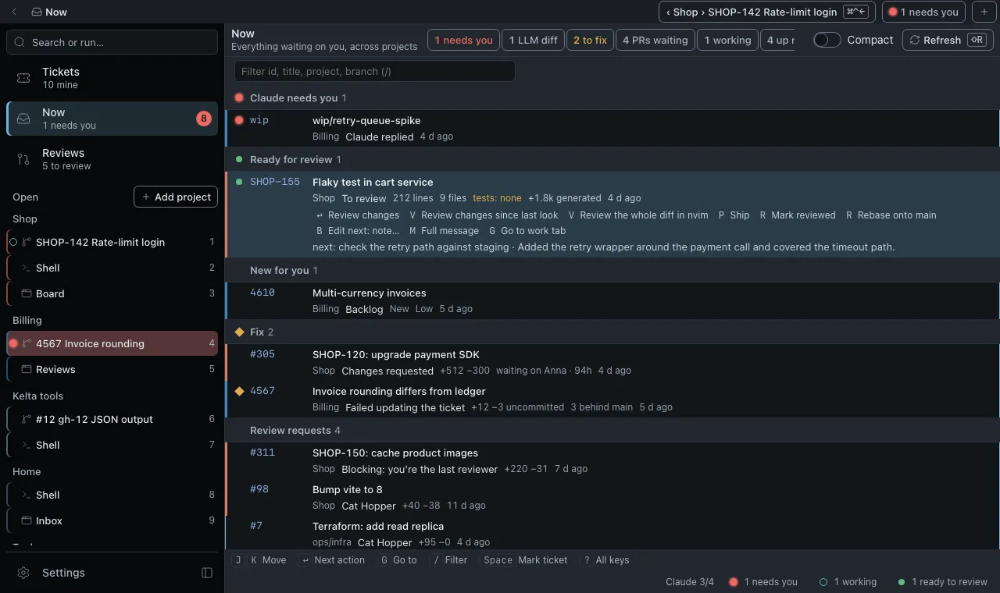
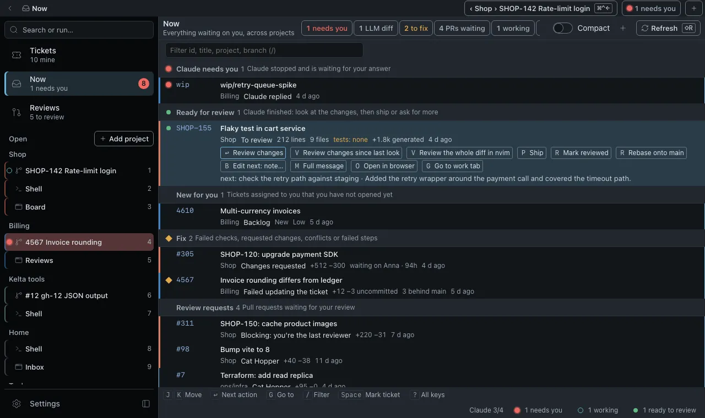
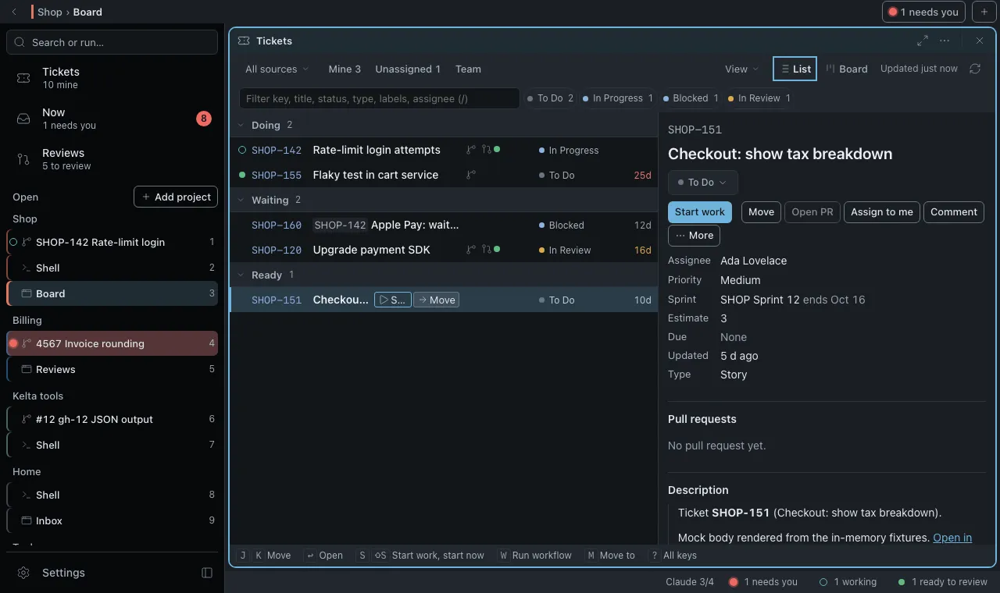
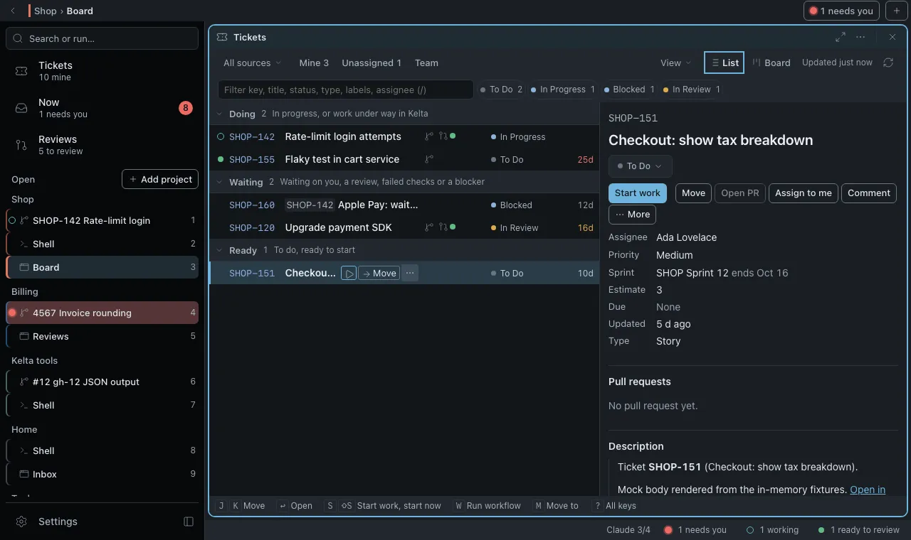
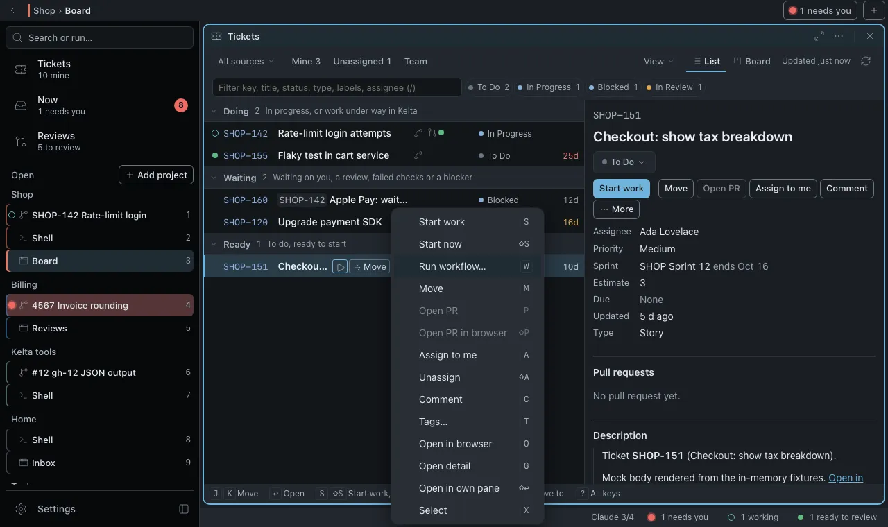
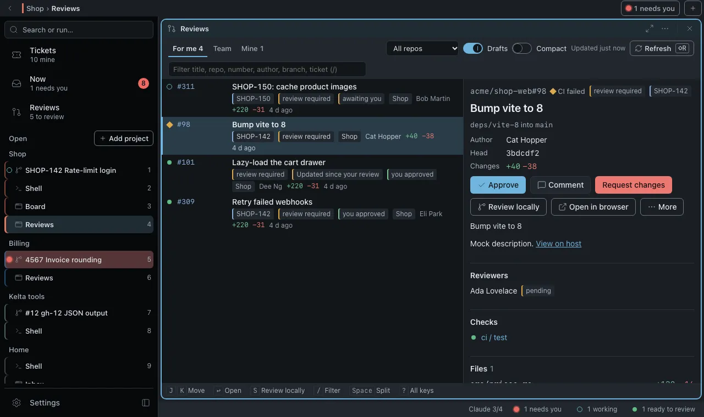
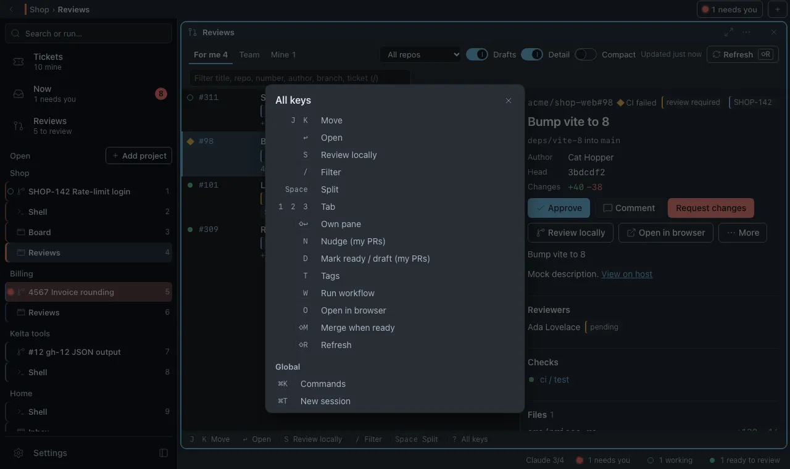

# UI pass #397: Tickets, Now and Reviews without the keyboard

Kelta stays keyboard first; this pass makes the three lists explain themselves to someone who has never
read FLOW.md. Keys still go faster, they no longer unlock anything. The pass keeps the Bezel language
(DESIGN.md): no new colour, no new type, no motion (#398 follows). It spends its one bold move on the
**row**: the selected row now says what it is, what state it is in and what you can do, in words.

Screenshots: 1280×760, dark, macOS chords, mock IPC (`docs/design/ui-pass-397/`).

## Rules applied

1. **Every action has a visible control.** The selected row shows its next step as an outlined button
   (accent), then `⋯`: a menu of every other key of the row with the key on the right, like a desktop
   menu bar. An entry that cannot run stays in the menu, off, with the reason as its tooltip.
2. **Words before symbols.** Each section and group header ends in one muted line that says what it holds
   and why. Lamps carry their reason as a tooltip; tabs carry what they list.
3. **One obvious next step per row.** The `Enter` action is the only accent-outlined control of a row.
4. **Shortcuts are taught, not required.** Keys show on the buttons (Now), in their tooltips (Tickets,
   Reviews) and in every menu entry. `? All keys` under each list is now a button that opens the full list.
5. **Mouse paths for list gestures.** Drag reorders Next up; Select in `⋯` (or Cmd/Ctrl+click) starts a
   multi-selection whose checkboxes then sit in the lamp track; the filter field was already visible.
6. **One vocabulary.** Menus reuse the labels of the ticket detail's action bar and the work menu (Start
   work, Move, Open PR, Assign to me, Run workflow…, Open review, Review locally, Nudge reviewers).

All chords that belong to the keys manager (New work item, Start marked) come from `chordFor`, so the
Linux chords of #396 show up without touching these views. Pane letters (`s`, `m`, `x`…) are the panes'
own keys and are written as such.

## Now

| Before | After |
|---|---|
|  |  |

- **Before**: the selected row listed its actions as key hints (`↵ Review changes  V Review the whole
  diff…`) that did nothing on a click. Section headers named the section only. `N` (new work) had no
  control. Next up reordered with `J` / `K` only.
- **After**: the hints are buttons, each with its key; the `Enter` one is accent-outlined. Ticket rows
  add Mark ticket (`Space`) and, while tickets are marked, Start marked (the `work.start` chord, which
  now opens the batch sheet when tickets are marked, as the key hints always said). Every header ends
  in its hint ("Tickets assigned to you that nobody started"). The header has a `+` New work item
  button (tooltip with its chord). Next up rows drag; the row they land on shows the accent line.
  Row lamps say their reason on hover.

## Tickets

| Before | After | `⋯` menu |
|---|---|---|
|  |  |  |

- **Before**: the selected row had Start work and Move; a dozen actions (assign, comment, PR in the
  browser, tags, workflows, select, start now, own pane) were keys named in the row tooltip. Flow group
  headers said "Waiting" without saying waiting on what. The detail column toggled with `Space` only.
- **After**: `⋯` after Move holds the rest, keys on the right; off entries say why ("No pull request is
  linked to this ticket yet."). Board cards carry the same `⋯`. While a selection exists the lamp track
  is a checkbox column, and the menu adds Clear selection. Flow headers end in their hint ("Waiting on
  you, a review, failed checks or a blocker"). Who tabs say what they list. View gains a Detail switch
  for the split column.

## Reviews

| Before | After | `? All keys` |
|---|---|---|
|  |  |  |

- **Before**: rows had no control at all; review locally, nudge, draft, merge when ready, tags, workflow
  and the browser were keys. Group by ticket (`G`) and the detail column (`Space`) had no switch.
- **After**: the selected row shows Open review (accent) and `⋯` with every key; Nudge, draft and Merge
  when ready stay listed on other people's PRs, off, with the reason. The toolbar gains Detail (wide
  panes) and Group by ticket (Team). Tabs explain themselves in their tooltip.

## Left out

- The rail and the work tab (the ticket's "then" step): their own pass.
- Range selection with Shift+click, and selecting rows in Now and Reviews (they have no multi-select key).
- Motion for menus and drags: #398.
